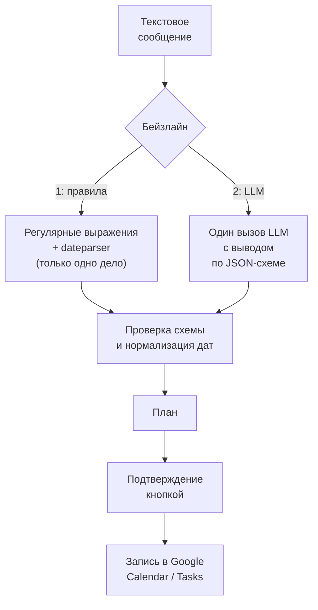
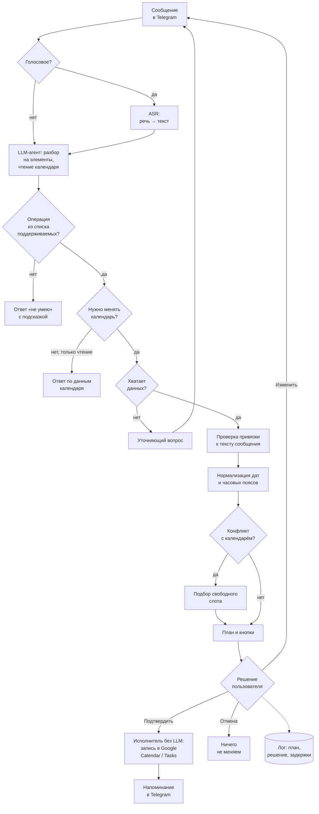

# ML System Design Doc - Chronos Agent

Chronos Agent – Telegram-бот для планирования дел с помощью текстовых и голосовых сообщений. Пользователь может перечислить несколько дел в свободной форме, а бот определит, какие из них относятся к встречам, задачам или напоминаниям, подготовит план и после подтверждения сохранит его в Google Calendar и Google Tasks.

## 1. Цели и предпосылки

### 1.1. Зачем идём в разработку продукта?

**Актуальность:** Повседневные дела часто возникают в ситуациях, когда неудобно открывать календарь и последовательно заполнять поля нового события. Человек может договориться о встрече в переписке, вспомнить о задаче по дороге или записать несколько поручений во время разговора. В таких случаях проще оставить заметку, например в «Избранном» Telegram, однако заметки не связаны с расписанием и сами по себе не напоминают о запланированном событии.

Календарь решает задачу напоминаний, но требует вручную указывать дату, время, длительность и другие параметры каждого события. Когда нужно запланировать сразу пять–десять дел, этот процесс занимает достаточно много времени, поэтому часть записей так и остаётся в заметках. Перенос уже созданной встречи тоже требует нескольких действий: нужно найти событие, проверить доступное время и изменить его параметры.

**Бизнес-цель** состоит в том, чтобы сократить время на создание и перенос дел и уменьшить вероятность того, что записанные планы будут забыты. Вместо последовательного заполнения форм пользователь сможет отправить одно сообщение в привычном разговорном формате:

> «завтра в 15 созвон с Петей на час, до пятницы сдать отчёт по МЛСД, в субботу купить подарок маме, напомни в четверг вечером позвонить в банк»

Такое сообщение содержит несколько разных действий, относительные даты и разговорные формулировки. Для его обработки используется языковая модель (LLM), которая выделяет отдельные дела и извлекает необходимые параметры. Дальнейшую проверку дат, времени и конфликтов с календарём выполняет программный код. В результате пользователь получает готовый план, который можно проверить и подтвердить одной кнопкой.

| Сейчас | С Chronos Agent |
|---|---|
| Каждое дело нужно добавлять через отдельную форму | Несколько дел можно передать одним текстовым или голосовым сообщением |
| Заметки не связаны с напоминаниями | Дела сохраняются в календаре с напоминаниями |
| Чтобы заметить конфликт, нужно проверить календарь | Бот проверяет конфликты и предлагает перенос |
| Для переноса встречи нужно вручную изменять событие | Можно написать: «перенеси созвон с Петей на завтра» |

На рынке уже существуют инструменты планирования: Reclaim, Motion, Todoist и ассистенты, встроенные в календари. Однако они либо не работают через Telegram, либо недостаточно хорошо обрабатывают разговорные сообщения со списками дел на русском языке, либо требуют перехода в отдельное приложение. Chronos Agent ориентирован на сценарий, в котором пользователь продолжает работать в привычном мессенджере.

Главным критерием успеха первой итерации будет **acceptance rate не ниже 80 %**. Это означает, что участники пилота должны подтверждать без исправлений не менее 80 % элементов плана, предложенных ботом. Правила расчёта метрики приведены в разделе 2.1.

### 1.2. Бизнес-требования и ограничения

**Бизнес-требования:**

- **Ввод сообщений:** Пользователь может отправлять текстовые и голосовые сообщения на русском языке, в том числе перечислять несколько дел в одном сообщении.

- **Управление календарём:** Бот позволяет создавать, просматривать, переносить и отменять события в Google Calendar.

- **Управление задачами:** Задачи, для которых не указано конкретное время выполнения, сохраняются в Google Tasks.

- **Учёт часового пояса:** Все даты и время интерпретируются с учётом часового пояса пользователя.

- **Проверка расписания:** При планировании встреч бот проверяет пересечения с существующими событиями и ищет свободные временные интервалы.

- **Разрешение конфликтов:** Если запланированное время занято, бот предлагает перенести встречу на подходящий свободный интервал.

- **Отправка напоминаний:** Уведомления о запланированных делах и встречах отправляются пользователю через Telegram.

- **Уточнение информации:** Если для выполнения запроса недостаточно данных, бот задаёт уточняющий вопрос, не пытаясь самостоятельно определить недостающие сведения.

- **Подтверждение действий:** Любые изменения в Google Calendar и Google Tasks выполняются только после явного подтверждения пользователя. Для управления предложенными действиями предусмотрены кнопки «Подтвердить», «Изменить» и «Отмена». До получения подтверждения бот может анализировать запрос и формировать план, но не вносить изменения.

Проект разрабатывается с учётом следующих **ограничений**:

| Ограничение | Условия |
|---|---|
| Платформы | Telegram, Google Calendar и Google Tasks |
| Приватность | В LLM передаются только события из временного окна запроса, а не весь календарь дополнительно с удалением или маскировкой персональной информации |
| Безопасность | Изменение календаря без подтверждения пользователя запрещено |
| Бюджет | Около 2 000 руб в месяц на LLM API и хостинг во время пилота |
| Язык | Основной язык — русский |

При проектировании особенно важно учитывать последствия ошибок. Неверный перенос или удаление события могут нарушить расписание, поэтому такие действия требуют дополнительных проверок. Ошибки при извлечении отдельных дел также нежелательны, но имеют меньшую стоимость, чем изменение не того события.

| Возможная ошибка | Стоимость ошибки | Способ снижения риска |
|---|---|---|
| Перенос или удаление не того события | Высокая | Если найдено несколько похожих событий, бот уточняет выбор. Любое изменение требует подтверждения. |
| Неверная дата, время или часовой пояс | Высокая | Вычисления выполняет код, а дата и часовой пояс показываются перед подтверждением. |
| Добавление дела, которого не было в сообщении | Средняя | Каждый элемент плана должен соответствовать фрагменту исходного текста, как описано в разделе 2.1. |
| Пропуск одного из дел | Средняя | Нераспознанные части сообщения отображаются как «не разобрано». |
| Лишний уточняющий вопрос | Низкая | Количество уточнений отслеживается отдельными метриками из раздела 2.1. |

Результатом первой итерации должен стать работающий бот, соответствующий требованиям и ограничениям.

**Пилотное тестирование** проводится в следующем порядке:

1. **Подключение Google-аккаунта:** При первом запуске пользователь авторизуется через OAuth. Бот получает часовой пояс из Google Calendar и предлагает подтвердить его.
2. **Тестирование функциональности:** Участники отправляют текстовые и голосовые сообщения с делами, просматривают предложенные ботом планы, подтверждают или корректируют их.
3. **Сбор данных:** Все предложения бота и действия пользователей сохраняются в логах для последующей оценки качества планирования.
4. **Оценка пользовательского опыта:** По завершении пилота участники проходят короткий опрос о том, помогает ли бот экономить время и готовы ли они пользоваться им в дальнейшем.

Успешность пилота определяется несколькими критериями, поскольку высокая доля подтверждений сама по себе не гарантирует удобства и безопасности продукта.

| Критерий | Порог успешности |
|---|---|
| Acceptance rate | Не менее 80 % |
| Изменения календаря без подтверждения | 0 |
| Время ответа, p95 | Не более 10 секунд для текста и 15 секунд для голоса |
| Метрики уточнений и пропусков | В пределах порогов раздела 2.1 |

После MVP продукт можно развивать за счёт персонализации. Бот сможет учитывать рабочие часы пользователя и привычную длительность встреч, а для действий, которые человек ранее всегда подтверждал, потенциально появится режим выполнения без дополнительного подтверждения. Среди других направлений развития рассматриваются утренний план на день, автоматическое распределение задач по свободным интервалам и подключение других календарей.

### 1.3. Границы первой итерации

**Первая итерация** охватывает все девять бизнес-требований из раздела 1.2. Кроме пользовательских функций, в объём MVP входят подготовка тестового набора, офлайн-оценка и сбор логов для расчёта онлайн-метрик.

В первую итерацию **не входят**:

- автоматические изменения без подтверждения и персонализация на основе истории пользователя;
- поддержка групповых чатов, общих календарей и согласования встреч между несколькими людьми;
- интеграция с другими календарями, кроме Google, и мессенджерами, кроме Telegram;
- дообучение собственной LLM;
- определение приоритетности дел;
- изменение событий, организатором которых пользователь не является.

**Качество кода и воспроизводимость:**

- проверки `ruff` и `pre-commit` должны выполняться при каждом коммите;
- зависимости управляются через `uv` и фиксируются в `uv.lock`, секреты хранятся в `.env` вне git, для запуска используется Docker Compose;
- unit-тесты для проверки обработки дат, часовых поясов, конфликтов и подбор свободных интервалов;
- ответы LLM на тестовом наборе записываются один раз, тесты в CI их воспроизводят и не
  обращаются к API;
- офлайн-оценка идёт на имитации календаря, не требующей подключения к Google;
- тестовый набор заморожен: версия, seed и модель-генератор записаны;
- все метрики считаются одной командой с сохранением отчёта.

**Технический долг:**

- напоминания будут обрабатываться фоновым циклом внутри процесса бота без отдельной очереди сообщений;
- для получения изменений календаря система будет периодически перечитывать данные, поддержка push-уведомлений Google может быть добавлена позднее;
- мониторинг ограничивается логами и простым отчётом.

### 1.4. Предпосылки решения

**Единицей предсказания** служит сообщение пользователя вместе с контекстом, необходимым для его интерпретации. В контекст входят текущий момент времени, часовой пояс, события календаря в окне вокруг упомянутых дат и последние реплики диалога.

Система различает три типа элементов планирования:
- **Встреча** имеет дату, время и длительность и сохраняется в Google Calendar.
- **Задача** имеет дату или срок выполнения, но не привязана к конкретному времени и сохраняется в Google Tasks.
- **Напоминание** соответствует уведомлению в определённый момент и записывается в Google Calendar как событие со статусом «свободен», чтобы не блокировать время в расписании.

**Основной часовой пояс** определяется по настройкам Google Calendar, но пользователь может изменить его командой. Если в тексте прямо указан другой часовой пояс, например «в 10 по Москве», приоритет отдаётся этому указанию. Во внутреннем представлении все временные значения хранятся в UTC.

Для некоторых неполных формулировок предусмотрены **стандартные значения**, каждый подставленный параметр отображается в плане перед подтверждением. Например, слово «вечером» может интерпретироваться как 19:00.

| Формулировка или ситуация | Значение по умолчанию |
|---|---|
| Не указана длительность встречи | 1 час |
| «Утром», «днём», «после обеда», «вечером» | Соответственно 9:00, 13:00, 14:00 и 19:00 |
| «До пятницы» | Срок включает пятницу |
| Не указано время напоминания о встрече | За 15 минут до начала |
| Для задачи не указана дата | Бот задаёт уточняющий вопрос |

**Правила работы с календарём:**
- Для событий, созданных ботом, отключаются стандартные уведомления Google, поскольку напоминания будут приходить через Telegram;
- При поиске конфликтов не учитываются события со статусом «свободен», отклонённые приглашения и события на весь день;
- Если пользователь просит изменить повторяющуюся встречу, по умолчанию изменяется только один экземпляр. Вся серия может быть изменена лишь по явному запросу и после дополнительного уточнения.
- Если у встречи есть участники, перед подтверждением бот сообщает, что они получат уведомление об изменении.

Обучение собственной модели в MVP не требуется. Для обработки запросов используются готовые LLM и ASR, а качество достигается настройкой промптов, схем инструментов и программными проверками.

## 2. Методология

### 2.1. Постановка задачи

С точки зрения ML задача Chronos Agent заключается в **извлечении структурированной информации из естественного языка** с помощью LLM-агента. Для голосовых сообщений этому этапу предшествует **автоматическое распознавание речи (ASR)**.

На вход системы поступают сообщение пользователя $u$, текущий момент $t$, часовой пояс $z$, набор событий календаря $S$ в соответствующем временном окне и история диалога $H$. На основании этих данных система должна выбрать один из четырёх возможных исходов.

| Исход | Условие | Пример |
|---|---|---|
| План $P$ | Нужно изменить календарь или задачи, и данных для этого достаточно | «завтра в 15 созвон с Петей» |
| Ответ на запрос | Пользователь запрашивает информацию без изменения данных | «что у меня завтра?» |
| Уточняющий вопрос | Данных недостаточно для однозначного плана | «созвон с Петей» без указания времени |
| Ответ «не умею» | Запрошенное действие не поддерживается | «закажи такси», «напиши Пете» |

План это список элементов $P = (a_1, \dots, a_k)$:

$$a_i = (\text{op}_i, \text{type}_i, \text{title}_i, \text{start}_i, \text{end}_i, \text{remind}_i, \text{target}_i, \text{span}_i)$$

Здесь $\text{op} \in \{\text{create}, \text{update}, \text{delete}\}$,
$\text{type} \in \{\text{event}, \text{task}, \text{reminder}\}$, $\text{target}$ задаёт
существующее событие для переноса или отмены, а $\text{span}$ хранит фрагмент сообщения, из
которого получен элемент.

Решение включает несколько подзадач, для каждой из которых выбран отдельный способ обработки.

| Подзадача | Тип задачи | Решение |
|---|---|---|
| Преобразование голоса в текст | ASR | Whisper |
| Выделение отдельных дел и определение их типа | Извлечение информации и классификация | LLM с выводом по JSON-схеме |
| Извлечение названия, даты, времени и длительности | Извлечение слотов | LLM извлекает значения, код нормализует даты |
| Определение события для переноса или отмены | Классификация и поиск | LLM с инструментом поиска по календарю |
| Выбор одного из четырёх исходов | Классификация | LLM с проверкой схемы в коде |
| Проверка конфликтов и поиск свободного времени | Эвристический алгоритм | Программный код без LLM |

**Принципы решения:**

1) **Разделении языковой интерпретации и детерминированных операций:** LLM отвечает за понимание формулировок и извлечение параметров, тогда как вычисление дат, часовых поясов, пересечений и свободных интервалов выполняется кодом. Это позволяет снизить риск арифметических ошибок языковой модели там, где они могут привести к неправильным действиям с календарём.

2) **Ограничение доступа к данным:** LLM не получает инструментов записи в календарь, ей доступны только операции чтения календаря, а также инструмент для возврата предложенного плана. Запись выполняет отдельный компонент без участия LLM только после нажатия пользователем кнопки «Подтвердить». Поэтому защита от неподтверждённых изменений обеспечивается архитектурой, а не только инструкциями в промпте.

**Офлайн-оценка** проводится на тестовом наборе и позволяет отдельно проверить полноту выделения дел, корректность их параметров, итоговое совпадение планов с эталоном и работу голосового ввода.

| Метрика | Что измеряет | Целевой порог |
|---|---|---|
| Item-level F1 | Полноту и точность выделения дел из сообщения | ≥ 0,90 |
| Type accuracy | Правильность определения типа элемента | ≥ 0,95 |
| Datetime accuracy | Точное совпадение времени начала и окончания | ≥ 0,95 |
| Plan match для одного дела | Полное совпадение плана с эталоном | ≥ 0,90 |
| Plan match для списка из 2–5 дел | Полное совпадение плана со списком дел | ≥ 0,70 |
| Outcome macro-F1 | Правильность выбора одного из четырёх исходов | ≥ 0,85 |
| Изменения без подтверждения | Записи в обход подтверждения, включая проверки с prompt injection | 0 |
| WER | Качество распознавания речи, вспомогательная метрика | ≤ 15 % |
| Plan match для голоса | Совпадение эталона по всей цепочке от голоса до плана | ≥ 0,70 |

**Онлайн-оценка** отражает то, как система работает с реальными пользователями во время пилота.

| Метрика | Целевой порог |
|---|---|
| Acceptance rate – доля элементов, подтверждённых без правок | **≥ 80 %** |
| Edit rate – доля исправленных элементов | ≤ 15 % |
| Cancel rate – доля отменённых элементов | ≤ 5 % |
| Undo rate – доля подтверждённых, но впоследствии отменённых элементов | ≤ 5 % |
| Доля сообщений без уточняющих вопросов | ≥ 70 % |
| Среднее число сообщений до подтверждения | ≤ 1,3 |
| Доля планов, для которых пользователь выбрал «что-то пропущено» | ≤ 5 % |
| Время ответа, p95 | ≤ 10 секунд для текста и ≤ 15 секунд для голоса |

Показатели acceptance rate, edit rate и cancel rate рассчитываются по элементам плана, а не по сообщениям. Если в одном сообщении было пять дел и пользователь исправил одно из них, в расчёте учитываются четыре подтверждённых элемента и один исправленный. Напоминания также входят в расчёт, а уточняющие вопросы и ответы на запросы о просмотре расписания не включаются в знаменатель.

Метрики уточнений и пропусков необходимы для корректной интерпретации acceptance rate. Бот не должен повышать этот показатель за счёт постоянных уточняющих вопросов или исключения сложных дел из плана. Первое поведение ухудшит долю сообщений без уточнений, а второе отразится на доле планов с отметкой «что-то пропущено».

Офлайн- и онлайн-метрики оценивают качество с разных сторон. Plan match требует полного совпадения с эталоном, хотя пользователь может считать приемлемыми разные формулировки одного и того же дела, например «Созвон с Петей» и «Звонок Пете».

### 2.2. Блок-схема решения

Ниже представлены схемы базовых подходов и итоговой архитектуры MVP. В бейзлайнах отсутствуют агентный цикл и доступ к календарю: первый вариант извлекает данные из сообщения с помощью правил, а второй использует один вызов LLM. После извлечения информации оба варианта проходят одинаковую проверку JSON-схемы и нормализацию дат, затем формируют план для подтверждения пользователем.

**Базовые решения:**

В архитектуре MVP добавляются распознавание голосовых сообщений, чтение календаря и возможность выбора дальнейшего действия в зависимости от содержания запроса. Агент может ответить на информационный вопрос, задать уточнение либо сформировать план изменений. Перед показом плана проверяются связь его элементов с исходным текстом, корректность дат и наличие конфликтов. Запись в Google Calendar или Google Tasks выполняется только отдельным исполнителем после подтверждения пользователя. Все предложения, решения и задержки фиксируются в логах.

**Архитектура MVP:**

### 2.3. Этапы решения задачи

Поскольку в MVP используются готовые модели, подготовка данных нужна прежде всего для оценки качества, а не для обучения. Анализ данных будет основан на реальных заметках из тестового набора: необходимо понять, как формулируются дела, насколько часто они перечисляются списком и какие способы указания дат используются.

#### Этап 1. Подготовка данных

На первом этапе формируется набор примеров, позволяющий оценить разные сценарии работы бота. Исходными материалами станут реальные заметки из Telegram из тестового набора, а также синтетические сообщения, записи голоса и состояния календаря.

| Источник данных | Текущее состояние | Способ получения или подготовки | Проверено ли качество |
|---|---|---|---|
| Реальные заметки с делами | Есть в заметках и «Избранном» Telegram (частично) | Анонимизация и ручная разметка | Нет |
| Синтетические сообщения с эталонным планом | Пока отсутствуют | Генерация по описанной ниже процедуре | Нет |
| Состояние календаря для каждого примера | Пока отсутствует | Генерация кодом вместе с эталоном | Да, формируется программно |
| Голосовые сообщения с расшифровкой и планом | Пока отсутствуют | Запись автором и участниками пилота с их согласия | Нет |
| Логи пилота с планами | Пока отсутствуют | Автоматическое сохранение во время пилота | Нет |

Для каждого сообщения **целевой переменной** выступает эталонный исход системы. Если исходом является план, дополнительно сохраняется список элементов со всеми полями.

Синтетические примеры будут создаваться **от эталонного плана к разговорному сообщению**. Если наоборот поручить LLM одновременно написать текст и определить правильный ответ, эталон может содержать ошибки. Поэтому генерация строится в следующем порядке:

1. Программный код создаёт эталонный план, состояние календаря и словесные обозначения дат, например «завтра», «в пятницу» или «вечером».
2. LLM по заданному плану формулирует естественное сообщение, сохраняя указанные обозначения дат.
3. Код проверяет наличие нужных формулировок и названий дел в полученном тексте, после чего автор вручную просматривает выборку примеров.

**Результат этапа:**

- Текстовый набор из 200–300 сообщений: около 60 % с одним делом и 40 % списков. В нём должны быть представлены все четыре исхода работы системы, переносы и отмены, повторяющиеся события, конфликты, опечатки и примеры prompt injection в названиях событий;
- Голосовой набор из 20-30 сообщений;
- Деление на dev для подбора и настройки промптов и закрытый test для итоговой оценки;
- Скрипт, который считает все офлайн-метрики по срезам: одно дело или список, абсолютные или относительные даты, текст или голос.

Основной риск связан с тем, что синтетические запросы могут оказаться проще реальных и дать завышенную оценку качества.

#### Этап 2. Бейзлайн 1: обработка правилами

Первый бейзлайн использует регулярные выражения и библиотеку для парсинга дат. Он рассчитан на простые одиночные команды, например «завтра в 15 созвон с Петей», и не предназначен для обработки списков или неполных запросов. Поэтому оценивать его предполагается только на той части test, где содержится одно дело.

Для этого бейзлайна измеряются Plan match и Datetime accuracy. Его результат задаёт нижнюю границу качества и помогает определить, насколько использование LLM оправдано.

#### Этап 3. Бейзлайн 2: один вызов LLM

Во втором бейзлайне сообщение обрабатывается одним запросом к LLM, которая возвращает результат по JSON-схеме. Модель не использует инструменты и не получает доступ к календарю, а нормализация дат, как и в первом варианте, происходит в коде.

Этот подход оценивается на всём наборе test. Для него рассчитываются все офлайн-метрики, не требующие работы с календарём, а также задержка и стоимость обработки. Второй бейзлайн служит основным ориентиром при оценке MVP: сравнение с ним должно показать, насколько дополнительные возможности агентной архитектуры оправдывают её сложность.

#### Этап 4. MVP: LLM-агент

Для MVP предполагается реализовать собственный несложный цикл вызова инструментов чтения и возврата плана. Использование отдельного агентного фреймворка, например LangGraph, на этом этапе не требуется.

Подходящая языковая модель выбирается по результатам сравнения трёх кандидатов на наборе `dev`. Основными критериями будут Plan match, задержка ответа и стоимость использования.

Основные риски этого этапа связаны с интерпретацией дат, выбором события для переноса и доступностью внешнего API. Ошибки с датами ограничиваются программными вычислениями и показом итогового времени перед подтверждением. Если при переносе найдено несколько похожих событий, бот должен уточнить, какое из них имеется в виду.

#### Этап 5. Голосовой ввод

Голосовые сообщения обрабатываются моделью Whisper.Для MVP выбирается наиболее компактная модель, которая обеспечивает требуемое качество и позволяет укладываться в 15 секунд на ответ. Поскольку шумные записи могут ухудшать распознавание, перед подтверждением бот показывает пользователю полученную расшифровку.

#### Этап 6. Пилотное тестирование

Для пилота создаётся OAuth-приложение Google в тестовом режиме. В исходном плане учитываются ограничения этого режима: не более 100 пользователей и срок действия refresh-токенов в семь дней. Если токен истекает, бот должен самостоятельно прислать ссылку для повторной авторизации.

Во время тестирования собираются онлайн-метрики из раздела 2.1, а после завершения участники проходят короткий опрос. На основании показателей и критериев успешности из раздела 1.2 принимается решение о следующей итерации продукта.
