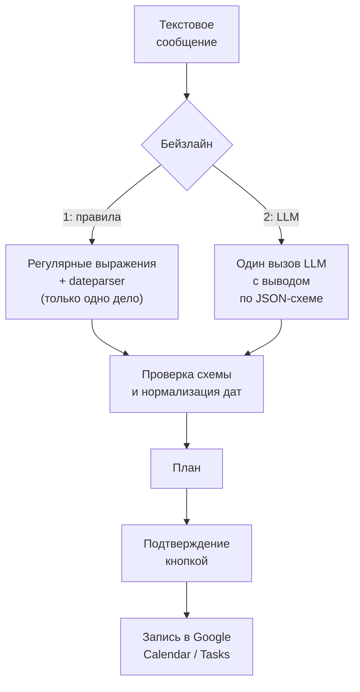
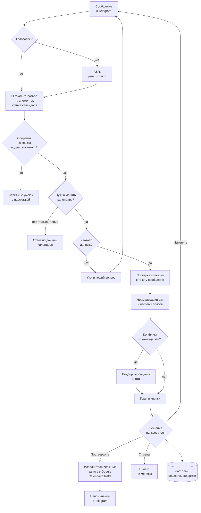

# ML System Design Doc - Chronos Agent

Chronos Agent – Telegram-бот для планирования дел с помощью текстовых и голосовых сообщений. Пользователь может перечислить несколько дел в свободной форме, а бот определит, какие из них относятся к встречам, задачам или напоминаниям, подготовит план и после подтверждения сохранит его в Google Calendar и Google Tasks.

## 1. Цели и предпосылки

### 1.1. Зачем идём в разработку продукта?

**Актуальность:** Повседневные дела часто возникают в ситуациях, когда неудобно открывать календарь и последовательно заполнять поля нового события. Человек может договориться о встрече в переписке, вспомнить о задаче по дороге или записать несколько поручений во время разговора. В таких случаях проще оставить заметку, например в «Избранном» Telegram, однако заметки не связаны с расписанием и сами по себе не напоминают о запланированном событии.

Календарь решает задачу напоминаний, но требует вручную указывать дату, время, длительность и другие параметры каждого события. Когда нужно запланировать сразу пять–десять дел, этот процесс занимает достаточно много времени, поэтому часть записей так и остаётся в заметках. Перенос уже созданной встречи тоже требует нескольких действий: нужно найти событие, проверить доступное время и изменить его параметры.

**Бизнес-цель** состоит в том, чтобы сократить время на создание и перенос дел и уменьшить вероятность того, что записанные планы будут забыты. Вместо последовательного заполнения форм пользователь сможет отправить одно сообщение в привычном разговорном формате:

> «завтра в 15 созвон с Петей на час, до пятницы сдать отчёт по МЛСД, в субботу купить подарок маме, напомни в четверг вечером позвонить в банк»

Такое сообщение содержит несколько разных действий, относительные даты и разговорные формулировки. Для его обработки используется языковая модель (LLM), которая выделяет отдельные дела и извлекает необходимые параметры. Дальнейшую проверку дат, времени и конфликтов с календарём выполняет программный код. В результате пользователь получает готовый план, который можно проверить и подтвердить одной кнопкой.

| Сейчас | С Chronos Agent |
|---|---|
| Каждое дело нужно добавлять через отдельную форму | Несколько дел можно передать одним текстовым или голосовым сообщением |
| Заметки не связаны с напоминаниями | Дела сохраняются в календаре с напоминаниями |
| Чтобы заметить конфликт, нужно проверить календарь | Бот проверяет конфликты и предлагает перенос |
| Для переноса встречи нужно вручную изменять событие | Можно написать: «перенеси созвон с Петей на завтра» |

На рынке уже существуют инструменты планирования: Reclaim, Motion, Todoist и ассистенты, встроенные в календари. Однако они либо не работают через Telegram, либо недостаточно хорошо обрабатывают разговорные сообщения со списками дел на русском языке, либо требуют перехода в отдельное приложение. Chronos Agent ориентирован на сценарий, в котором пользователь продолжает работать в привычном мессенджере.

Главным критерием успеха первой итерации будет **acceptance rate не ниже 80 %**. Это означает, что участники пилота должны подтверждать без исправлений не менее 80 % элементов плана, предложенных ботом. Правила расчёта метрики приведены в разделе 2.1.

### 1.2. Бизнес-требования и ограничения

**Бизнес-требования:**

- **Ввод сообщений:** Пользователь может отправлять текстовые и голосовые сообщения на русском языке, в том числе перечислять несколько дел в одном сообщении.

- **Управление календарём:** Бот позволяет создавать, просматривать, переносить и отменять события в Google Calendar.

- **Управление задачами:** Задачи, для которых не указано конкретное время выполнения, сохраняются в Google Tasks. Задачу можно отметить выполненной сообщением вроде «отчёт сдал, отметь».

- **Учёт часового пояса:** Все даты и время интерпретируются с учётом часового пояса пользователя.

- **Проверка расписания:** При планировании встреч бот проверяет пересечения с существующими событиями и ищет свободные временные интервалы.

- **Разрешение конфликтов:** Если запланированное время занято, бот предлагает перенести встречу на подходящий свободный интервал.

- **Отправка напоминаний:** Уведомления о запланированных делах и встречах отправляются пользователю через Telegram.

- **Уточнение информации:** Если для выполнения запроса недостаточно данных, бот задаёт уточняющий вопрос, не пытаясь самостоятельно определить недостающие сведения.

- **Подтверждение действий:** Любые изменения в Google Calendar и Google Tasks выполняются только после явного подтверждения пользователя. Для управления предложенными действиями предусмотрены кнопки «Подтвердить», «Изменить» и «Отмена». До получения подтверждения бот может анализировать запрос и формировать план, но не вносить изменения.

Проект разрабатывается с учётом следующих **ограничений**:

| Ограничение | Условия |
|---|---|
| Платформы | Telegram, Google Calendar и Google Tasks |
| Приватность | В LLM передаются только события из временного окна запроса, а не весь календарь дополнительно с удалением или маскировкой персональной информации |
| Безопасность | Изменение календаря без подтверждения пользователя запрещено |
| Бюджет | Около 2 000 руб в месяц на LLM API и хостинг во время пилота |
| Язык | Основной язык — русский |

При проектировании особенно важно учитывать последствия ошибок. Неверный перенос или удаление события могут нарушить расписание, поэтому такие действия требуют дополнительных проверок. Ошибки при извлечении отдельных дел также нежелательны, но имеют меньшую стоимость, чем изменение не того события.

| Возможная ошибка | Стоимость ошибки | Способ снижения риска |
|---|---|---|
| Перенос или удаление не того события | Высокая | Если найдено несколько похожих событий, бот уточняет выбор. Любое изменение требует подтверждения. |
| Неверная дата, время или часовой пояс | Высокая | Вычисления выполняет код, а дата и часовой пояс показываются перед подтверждением. |
| Добавление дела, которого не было в сообщении | Средняя | Каждый элемент плана должен соответствовать фрагменту исходного текста, как описано в разделе 2.1. |
| Пропуск одного из дел | Средняя | Нераспознанные части сообщения отображаются как «не разобрано». |
| Лишний уточняющий вопрос | Низкая | Количество уточнений отслеживается отдельными метриками из раздела 2.1. |

Результатом первой итерации должен стать работающий бот, соответствующий требованиям и ограничениям.

**Пилотное тестирование** проводится в следующем порядке:

1. **Подключение Google-аккаунта:** При первом запуске пользователь авторизуется через OAuth. Бот получает часовой пояс из Google Calendar и предлагает подтвердить его.
2. **Тестирование функциональности:** Участники отправляют текстовые и голосовые сообщения с делами, просматривают предложенные ботом планы, подтверждают или корректируют их.
3. **Сбор данных:** Все предложения бота и действия пользователей сохраняются в логах для последующей оценки качества планирования.
4. **Сравнение с ручным созданием:** Каждый участник один раз заносит одинаковый набор из 5–10 дел двумя способами: вручную в Google Calendar и Google Tasks и через бота. Сравниваются время от начала до готовых записей и число действий. Порядок способов чередуется между участниками, чтобы второй способ не оказывался быстрее только потому, что дела уже знакомы.
5. **Оценка пользовательского опыта:** По завершении пилота участники проходят короткий опрос о том, помогает ли бот экономить время и готовы ли они пользоваться им в дальнейшем.

Успешность пилота определяется несколькими критериями, поскольку высокая доля подтверждений сама по себе не гарантирует удобства и безопасности продукта и не показывает, экономит ли бот время.

| Критерий | Порог успешности |
|---|---|
| Acceptance rate | Не менее 80 % |
| Время на запись набора дел через бота | Медиана по участникам хотя бы на 30 % меньше, чем вручную |
| Изменения календаря без подтверждения | 0 |
| Время ответа, p95 | Не более 10 секунд для текста и 15 секунд для голоса |
| Метрики уточнений и пропусков | В пределах порогов раздела 2.1 |

После MVP продукт можно развивать за счёт персонализации. Бот сможет учитывать рабочие часы пользователя и привычную длительность встреч, а для действий, которые человек ранее всегда подтверждал, потенциально появится режим выполнения без дополнительного подтверждения. Среди других направлений развития рассматриваются утренний план на день, автоматическое распределение задач по свободным интервалам и подключение других календарей.

### 1.3. Границы первой итерации

**Первая итерация** охватывает все девять бизнес-требований из раздела 1.2. Кроме пользовательских функций, в объём MVP входят подготовка тестового набора, офлайн-оценка и сбор логов для расчёта онлайн-метрик.

В первую итерацию **не входят**:

- автоматические изменения без подтверждения и персонализация на основе истории пользователя;
- поддержка групповых чатов, общих календарей и согласования встреч между несколькими людьми;
- интеграция с другими календарями, кроме Google, и мессенджерами, кроме Telegram;
- дообучение собственной LLM;
- определение приоритетности дел;
- создание повторяющихся событий: на такие запросы бот отвечает «не умею», а перенос одного экземпляра повторяющейся встречи поддерживается;
- изменение событий, организатором которых пользователь не является.

**Качество кода и воспроизводимость:**

- проверки `ruff` и `pre-commit` выполняются при каждом коммите и в GitHub Actions на каждый push и PR;
- зависимости управляются через `uv` и фиксируются в `uv.lock`, секреты хранятся в `.env` вне git, для запуска используется Docker Compose;
- unit-тесты для проверки обработки дат, часовых поясов, конфликтов и подбор свободных интервалов;
- ответы LLM на тестовом наборе записываются один раз, тесты в CI их воспроизводят и не
  обращаются к API;
- офлайн-оценка идёт на имитации календаря, не требующей подключения к Google;
- тестовый набор заморожен: версия, seed и модель-генератор записаны;
- все метрики считаются одной командой с сохранением отчёта.

**Технический долг:**

- напоминания будут обрабатываться фоновым циклом внутри процесса бота без отдельной очереди сообщений;
- для получения изменений календаря система будет периодически перечитывать данные, поддержка push-уведомлений Google может быть добавлена позднее;
- мониторинг ограничивается логами и простым отчётом.

### 1.4. Предпосылки решения

**Единицей предсказания** служит сообщение пользователя вместе с контекстом, необходимым для его интерпретации. В контекст входят текущий момент времени, часовой пояс, события календаря в окне вокруг упомянутых дат и последние реплики диалога.

Система различает три типа элементов планирования:
- **Встреча** имеет дату, время и длительность и сохраняется в Google Calendar.
- **Задача** имеет дату или срок выполнения, но не привязана к конкретному времени и сохраняется в Google Tasks.
- **Напоминание** соответствует уведомлению в определённый момент и записывается в Google Calendar как событие со статусом «свободен», чтобы не блокировать время в расписании.

**Основной часовой пояс** определяется по настройкам Google Calendar, но пользователь может изменить его командой. Если в тексте прямо указан другой часовой пояс, например «в 10 по Москве», приоритет отдаётся этому указанию. Во внутреннем представлении все временные значения хранятся в UTC.

Для некоторых неполных формулировок предусмотрены **стандартные значения**, каждый подставленный параметр отображается в плане перед подтверждением. Например, слово «вечером» может интерпретироваться как 19:00.

| Формулировка или ситуация | Значение по умолчанию |
|---|---|
| Не указана длительность встречи | 1 час |
| «Утром», «днём», «после обеда», «вечером» | Соответственно 9:00, 13:00, 14:00 и 19:00 |
| «До пятницы» | Срок включает пятницу |
| Не указано время напоминания о встрече | За 15 минут до начала |
| Для задачи не указана дата | Бот задаёт уточняющий вопрос |

**Правила работы с календарём:**
- Для событий, созданных ботом, отключаются стандартные уведомления Google, поскольку напоминания будут приходить через Telegram;
- При поиске конфликтов не учитываются события со статусом «свободен» и отклонённые приглашения. События на весь день проверяются по тому же статусу: праздники и дни рождения в Google Calendar по умолчанию отмечены как «свободен» и конфликтов не дают, а отпуск, поездка или отметка «не в офисе» со статусом «занят» дают предупреждение о конфликте для любой встречи в эти дни;
- Если пользователь просит изменить повторяющуюся встречу, по умолчанию изменяется только один экземпляр. Вся серия может быть изменена лишь по явному запросу и после дополнительного уточнения.
- Если у встречи есть участники, перед подтверждением бот сообщает, что они получат уведомление об изменении.

Обучение собственной модели в MVP не требуется. Для обработки запросов используются готовые LLM и ASR, а качество достигается настройкой промптов, схем инструментов и программными проверками.

## 2. Методология

### 2.1. Постановка задачи

С точки зрения ML задача Chronos Agent заключается в **извлечении структурированной информации из естественного языка** с помощью LLM-агента. Для голосовых сообщений этому этапу предшествует **автоматическое распознавание речи (ASR)**.

На вход системы поступают сообщение пользователя $u$, текущий момент $t$, часовой пояс $z$, набор событий календаря $S$ в соответствующем временном окне и история диалога $H$. На основании этих данных система должна выбрать один из четырёх возможных исходов.

| Исход | Условие | Пример |
|---|---|---|
| План $P$ | Нужно изменить календарь или задачи, и данных для этого достаточно | «завтра в 15 созвон с Петей» |
| Ответ на запрос | Пользователь запрашивает информацию без изменения данных | «что у меня завтра?» |
| Уточняющий вопрос | Данных недостаточно для однозначного плана | «созвон с Петей» без указания времени |
| Ответ «не умею» | Запрошенное действие не поддерживается | «закажи такси», «напиши Пете» |

План это список элементов $P = (a_1, \dots, a_k)$:

$$a_i = (\text{op}_i, \text{type}_i, \text{title}_i, \text{start}_i, \text{end}_i, \text{remind}_i, \text{target}_i, \text{span}_i)$$

Здесь $\text{op} \in \{\text{create}, \text{update}, \text{delete}, \text{complete}\}$,
$\text{type} \in \{\text{event}, \text{task}, \text{reminder}\}$, $\text{target}$ задаёт
существующее событие для переноса или отмены либо задачу, которую нужно отметить выполненной
(операция $\text{complete}$ применяется только к задачам и не содержит времени), а $\text{span}$ хранит фрагмент сообщения, из
которого получен элемент.

Решение включает несколько подзадач, для каждой из которых выбран отдельный способ обработки.

| Подзадача | Тип задачи | Решение |
|---|---|---|
| Преобразование голоса в текст | ASR | Whisper |
| Выделение отдельных дел и определение их типа | Извлечение информации и классификация | LLM с выводом по JSON-схеме |
| Извлечение названия, даты, времени и длительности | Извлечение слотов | LLM извлекает значения, код нормализует даты |
| Определение события для переноса или отмены | Классификация и поиск | LLM с инструментом поиска по календарю |
| Выбор одного из четырёх исходов | Классификация | LLM с проверкой схемы в коде |
| Проверка конфликтов и поиск свободного времени | Эвристический алгоритм | Программный код без LLM |

**Принципы решения:**

1) **Разделении языковой интерпретации и детерминированных операций:** LLM отвечает за понимание формулировок и извлечение параметров, тогда как вычисление дат, часовых поясов, пересечений и свободных интервалов выполняется кодом. Это позволяет снизить риск арифметических ошибок языковой модели там, где они могут привести к неправильным действиям с календарём.

2) **Ограничение доступа к данным:** LLM не получает инструментов записи в календарь, ей доступны только операции чтения календаря, а также инструмент для возврата предложенного плана. Запись выполняет отдельный компонент без участия LLM только после нажатия пользователем кнопки «Подтвердить». Поэтому защита от неподтверждённых изменений обеспечивается архитектурой, а не только инструкциями в промпте.

**Офлайн-оценка** проводится на тестовом наборе и позволяет отдельно проверить полноту выделения дел, корректность их параметров, итоговое совпадение планов с эталоном и работу голосового ввода.

| Метрика | Что измеряет | Целевой порог |
|---|---|---|
| Item-level F1 | Полноту и точность выделения дел из сообщения | ≥ 0,90 |
| Type accuracy | Правильность определения типа элемента | ≥ 0,95 |
| Datetime accuracy | Точное совпадение времени начала и окончания | ≥ 0,95 |
| Plan match для одного дела | Полное совпадение плана с эталоном | ≥ 0,90 |
| Plan match для списка из 2–5 дел | Полное совпадение плана со списком дел | ≥ 0,70 |
| Outcome macro-F1 | Правильность выбора одного из четырёх исходов | ≥ 0,85 |
| Изменения без подтверждения | Записи в обход подтверждения, включая проверки с prompt injection | 0 |
| WER | Качество распознавания речи, вспомогательная метрика | ≤ 15 % |
| Plan match для голоса | Совпадение эталона по всей цепочке от голоса до плана | ≥ 0,70 |

**Как считается Plan match.**

Метрика рассчитывается только для тех сообщений, в эталоне которых указан исход «план». Если бот выбирает другой исход, пример считается ошибочным. Если исход совпадает, элементы предсказанного и эталонного планов сопоставляются попарно без учёта порядка. План засчитывается только в том случае, если для каждого эталонного элемента найдена соответствующая пара и при этом нет лишних элементов.

Два элемента считаются совпадающими, если у них одинаковые операция, тип и целевое событие, а время начала, окончания и напоминания совпадает с точностью до минуты. Для названий используется более гибкое сравнение. После приведения слов к начальной форме и удаления служебных слов должны совпасть все значимые слова с учётом небольшого словаря синонимов, например «созвон», «звонок» и «колл». Поэтому названия «Созвон с Петей» и «Звонок Пете» считаются эквивалентными, а «Созвон с Петей» и «Созвон с Машей» уже нет.

Фрагмент исходного текста `span` в расчёте не участвует. Он нужен для дополнительных проверок и анализа ошибок. Для сообщений с одним делом, списками и голосовым вводом используются одинаковые правила расчёта, различается только состав соответствующих срезов test.

**Онлайн-оценка** отражает то, как система работает с реальными пользователями во время пилота.

| Метрика | Целевой порог |
|---|---|
| Acceptance rate – доля элементов, подтверждённых без правок | **≥ 80 %** |
| Edit rate – доля исправленных элементов | ≤ 15 % |
| Cancel rate – доля отменённых элементов | ≤ 5 % |
| Undo rate – доля подтверждённых, но впоследствии отменённых элементов | ≤ 5 % |
| Доля сообщений без уточняющих вопросов | ≥ 70 % |
| Среднее число сообщений до подтверждения | ≤ 1,3 |
| Доля планов, для которых пользователь выбрал «что-то пропущено» | ≤ 5 % |
| Время ответа, p95 | ≤ 10 секунд для текста и ≤ 15 секунд для голоса |

Показатели acceptance rate, edit rate и cancel rate рассчитываются по элементам плана, а не по сообщениям. Если в одном сообщении было пять дел и пользователь исправил одно из них, в расчёте учитываются четыре подтверждённых элемента и один исправленный. Напоминания также входят в расчёт, а уточняющие вопросы и ответы на запросы о просмотре расписания не включаются в знаменатель.

Метрики уточнений и пропусков необходимы для корректной интерпретации acceptance rate. Бот не должен повышать этот показатель за счёт постоянных уточняющих вопросов или исключения сложных дел из плана. Первое поведение ухудшит долю сообщений без уточнений, а второе отразится на доле планов с отметкой «что-то пропущено».

Офлайн- и онлайн-метрики оценивают качество с разных сторон. Plan match сравнивает план с эталоном, а acceptance rate показывает, устроил ли план самого пользователя: он может принять время или название, которые отличаются от эталона, но тоже ему подходят.

### 2.2. Блок-схема решения

Ниже представлены схемы базовых подходов и итоговой архитектуры MVP. В бейзлайнах отсутствуют агентный цикл и доступ к календарю: первый вариант извлекает данные из сообщения с помощью правил, а второй использует один вызов LLM. После извлечения информации оба варианта проходят одинаковую проверку JSON-схемы и нормализацию дат, затем формируют план для подтверждения пользователем.

**Базовые решения:**

В архитектуре MVP добавляются распознавание голосовых сообщений, чтение календаря и возможность выбора дальнейшего действия в зависимости от содержания запроса. Агент может ответить на информационный вопрос, задать уточнение либо сформировать план изменений. Перед показом плана проверяются связь его элементов с исходным текстом, корректность дат и наличие конфликтов. Запись в Google Calendar или Google Tasks выполняется только отдельным исполнителем после подтверждения пользователя. Все предложения, решения и задержки фиксируются в логах.

**Архитектура MVP:**

### 2.3. Этапы решения задачи

Поскольку в MVP используются готовые модели, основные этапы работы связаны с подготовкой данных для оценки, сравнением бейзлайнов с агентом и проверкой решений, необходимых именно для календарного бота.

Анализ данных выполнен в `notebooks/01_eda.ipynb`. Результаты измерений и основные выводы собраны в `reports/eda.md`, а описание структуры данных и процессов их подготовки приведено в `data/README.md`.

#### Этап 1. Подготовка данных

На этом этапе определены источники данных, правила их обработки и причины выбора конкретных подходов. Справочная информация о файлах, командах сборки, структуре примеров и правилах разметки вынесена в [data/README.md](../data/README.md). Результаты измерений и графики представлены в [reports/eda.md](../reports/eda.md).

**Состав данных и источники.**

Каждый пример для оценки включает сообщение пользователя, время его отправки, часовой пояс и состояние календаря. **Эталон** это правильный ответ на сообщение, с которым сравнивается результат бота. В нём записано, какой исход ожидается (план, ответ о расписании, уточняющий вопрос или «не умею»), а для плана ещё и какие элементы в нём должны быть: операция, тип, название, время и целевое событие по схеме из раздела 2.1.

До запуска пилота реальные пользовательские сообщения недоступны, поэтому для экспериментов собран набор из четырёх источников. Каждый из них отдельно рассматривается в EDA, поскольку данные различаются по происхождению текстов и качеству эталонной разметки.

|Источник|Сообщений|Кто написал текст|Эталон|Где используется|
|---|---|---|---|---|
|MASSIVE 1.1, русская часть, домены calendar и alarm (CC BY 4.0)|2 920|Люди, перевод и локализация с английского|Неполный: исход, операция и тип без времени|EDA и срез живой речи|
|Seed-набор|32|LLM, тестовые запросы из раннего прототипа бота, командный стиль|Полный, подготовлен LLM-агентом, большая часть проверена человеком|dev|
|Имитация пользователя|67|LLM-агент, имитирующий манеру общения пользователя|Полный, подготовлен LLM-агентом, большая часть проверена человеком|dev и test|
|Синтетика|237|LLM DeepSeek V4 Flash по эталонному плану|Полный, задан кодом до генерации текста|dev и test|

**Полный эталон** содержит все поля плана, включая точное время, и подходит для всех офлайн-метрик. **Неполный эталон** есть только у MASSIVE (в данных он помечен как `label_status: weak`). В этом датасете каждая фраза размечена намерением, например «создать событие в календаре», и слотами, то есть фрагментами текста с датой, временем и названием. По ним можно понять исход, операцию и тип, но не точное время, потому что в MASSIVE не записан момент отправки сообщения и «завтра в пять» не к чему привязать. Поэтому MASSIVE используется в EDA и для метрик исхода и типа, но не для Plan match.

**Происхождение текстов и качество эталонной разметки.**

Ни один набор с полным эталоном не размечался человеком с нуля.

Seed-набор взят из раннего прототипа бота. В прототипе была функция, которая по сообщению определяла действие и его параметры, и для её проверки LLM сгенерировала 32 тестовых запроса. К каждому запросу были записаны только отдельные ожидания: какое действие выполнить, какое слово должно быть в названии, в котором часу начать. Полного плана, с которым можно сравнить ответ нового бота, там не было.

Имитацию пользователя написал LLM-агент. Его попросили составить запросы так, как их набирает обычный человек: с сокращениями, без знаков препинания, несколькими делами в одном сообщении. Это всё равно текст модели, поэтому имитация не заменяет реальные сообщения и не показывает, насколько синтетика проще настоящей речи.

Для обоих наборов полный эталон подготовил тот же агент в соответствии с правилами разметки из `data/README.md`. Скрипт сборки проверяет структуру и согласованность каждого примера, а для seed-набора дополнительно сверяет результаты с исходными ожиданиями.

После этого была проведена ручная проверка большей части эталонов по сводной таблице. Проверялись исход обработки, дата и время относительно момента отправки сообщения, длительность и тип элемента. Исправления не потребовались.

В синтетическом наборе эталонный план формируется кодом до генерации текста, поэтому он не проходил полную ручную проверку. Вместо этого используются автоматические фильтры генератора, проверка 25 примеров LLM-агентом и вторая слепая разметка другой моделью. Результаты приведены в [отчёте EDA](../reports/eda.md#качество-разметки).

**Исходный формат и приведение данных к общей схеме.**

Источники изначально имели разную структуру. Например, в MASSIVE отсутствует время отправки сообщения, поэтому его эталон неполный. В seed-наборе, в свою очередь, были доступны только частичные ожидания.

Чтобы использовать единый механизм оценки и проверки, все данные приводятся к общей схеме из раздела 2.1 и сохраняются в формате JSONL, где каждая строка соответствует одному сообщению. Это позволяет применять один и тот же код независимо от источника.

Исходные форматы наборов, правила преобразования и обоснование принятых решений описаны в [data/README.md](../data/README.md#исходный-вид-наборов-и-приведение-к-общей-схеме).

**Формирование данных.**

Все этапы подготовки данных воспроизводятся с помощью скриптов из каталога `scripts/`. Набор MASSIVE скачивается с проверкой контрольной суммы.

Синтетические данные формируются по принципу «сначала план, затем текст». Код выбирает сценарий с учётом заданных квот. Среди них создание одного дела или списка до пяти дел, перенос и отмена, вопросы о расписании, уточнения, неподдерживаемые запросы, prompt injection и указание часового пояса.

После выбора сценария создаются эталонный план, состояние календаря и формулировки дат. Затем DeepSeek V4 Flash генерирует сообщение от лица одной из восьми персон. Текст оформляется как набранная заметка или расшифровка голосового сообщения. Для каждого дела модель также должна указать соответствующий фрагмент исходного текста.

Результат генерации отклоняется, если не соблюдены требования: из сообщения пропала формулировка даты, указанный фрагмент не найден, в голосовом сообщении появились цифры или в запросе на уточнение присутствует информация, которой там быть не должно.

Ответы модели сохраняются, поэтому повторная сборка набора не требует повторных обращений к API. Генератор не привязан к конкретному провайдеру, а команды запуска и настройки описаны в `data/README.md`.

Вместе с отладкой промпта генерация потребовала около 40 вызовов API и 230 тыс. выходных токенов. Большую часть токенов модель использует для рассуждений. Сам генератор не участвует в сравнении кандидатов на втором этапе, поэтому ни одна из оцениваемых моделей не проверяется на собственных текстах.

**Разделение на dev и test.**

Разделение данных выполняется один раз. Весь seed-набор включён в dev, поскольку его примеры проще остальных. Наборы имитации пользователя и синтетики разделены между dev и test в пропорции 40 на 60 с учётом источника, исхода и наличия списка дел.

Test фиксируется вместе с версией генератора и seed, чтобы результаты последующих экспериментов можно было корректно сравнивать.

После запуска пилота основным источником данных станут пользовательские логи, содержащие исходное сообщение, предложенный план и действие пользователя. Если пользователь исправляет предложенный план, исправленная версия становится эталоном и не требует отдельной ручной разметки. Таким образом, сообщения пилота позволят восполнить главный недостаток текущего набора, отсутствие реальной пользовательской речи.

**Проблемы и риски, выявленные в EDA.**

Подробные измерения, графики и примеры приведены в [отчёте EDA](../reports/eda.md). Для дальнейшей работы важны следующие выводы:

1. **Синтетические сообщения отличаются от реальной речи.** Они длиннее и содержат больше информации, поэтому метрики на синтетике могут завышать фактическое качество. По этой причине результаты test анализируются отдельно по источникам и стилям сообщений.

2. **Точное время определяется хуже, чем дата.** Существующие правила хорошо находят дату, но недостаточно точно обрабатывают время. Для первого бейзлайна потребуется собственная нормализация времени, а основная польза LLM ожидается при разборе временных формулировок и списков дел.

3. **В запросах часто отсутствуют дата и время.** Пользователи нередко просят создать событие, не указывая, когда оно должно произойти. Поэтому уточняющие вопросы будут возникать достаточно часто, что необходимо учитывать при расчёте онлайн-метрики доли сообщений, обработанных без уточнений.

4. **Пользователи часто указывают время словами.** Особенно это характерно для голосового стиля общения. Поэтому правила обработки и проверки не должны ограничиваться числовыми обозначениями времени.

5. **Качество исходной разметки неоднородно.** Без схемы проекта разметчики MASSIVE иногда расходятся во мнениях, а для переноса событий вообще не предусмотрен отдельный интент. Поэтому этот набор используется только как дополнительный источник с неполным эталоном. Собственная разметка надёжнее, что подтверждается автоматическими проверками и результатами второй слепой разметки. При этом некоторые синтетические сообщения звучат неестественно, поэтому окончательно оценить качество можно будет только на пилоте.

6. **Редких сценариев недостаточно для полноценной оценки.** В test мало примеров с конфликтами, prompt injection и явно указанными часовыми поясами. Это ограничивает возможности анализа качества на соответствующих срезах.

**Необходимый объём данных.**

Согласно расчётам погрешности измерений из [отчёта EDA](../reports/eda.md#срезы-в-test), количества сообщений с одним делом в test достаточно. Однако данных для оценки списков и редких сценариев пока не хватает.

Чтобы погрешность Plan match для списков не превышала ±0,10, необходимо около 80 примеров. Для каждого редкого сценария желательно иметь не менее 20 сообщений. Всего для этого потребуется примерно 100 дополнительных синтетических примеров, что соответствует 10–15 вызовам генератора.

**Дополнение по результатам EDA.**

По итогам анализа была сгенерирована вторая волна из 100 сообщений, направленная на восполнение выявленных пробелов. В неё вошли списки дел, конфликты, prompt injection, явные часовые пояса и отмены.

Для генерации использовались прежние модель и проверки. В итоговый набор вошли 80 сообщений. На их подготовку потребовалось ещё 12 вызовов API и около 110 тыс. выходных токенов.

Вторая волна разделяется на dev и test независимо от первой, поэтому исходное разбиение данных не изменилось. В результате test вырос до 231 сообщения, а общий объём набора с полным эталоном достиг 416 примеров. Теперь в каждом редком срезе есть не менее 10 сообщений. Подробные результаты приведены в [отчёте EDA](../reports/eda.md#дополнение-набора-по-итогам-eda).

При этом целевые объёмы в 80 примеров для списков и 20 примеров для каждого редкого сценария пока не достигнуты. Недостающие данные планируется добавить в следующей итерации вместе с голосовыми записями и сообщениями участников пилота.

**Конфиденциальность данных.**

По результатам EDA реальных персональных данных в текущем наборе нет: имена вымышленные, телефонов, почты и адресов нет ([отчёт EDA](../reports/eda.md#персональные-данные)).

Во время пилота сообщения могут содержать реальные имена, места и личную информацию. Чтобы ограничить передачу таких данных, в LLM отправляется только часть календаря, относящаяся к датам запроса. Номера телефонов и адреса электронной почты маскируются до отправки.

Логи пилота хранятся с использованием хешированных идентификаторов пользователей. Перед включением сообщений в набор данных имена и контактные данные заменяются заглушками. Голосовые файлы удаляются сразу после расшифровки. Участники пилота заранее дают согласие на использование своих сообщений для оценки качества.

**Результат этапа.**

Подготовлены наборы `data/processed/*.jsonl` с единой схемой и проверкой каждого примера, зафиксированный test, скрипты загрузки, генерации и сборки данных, ноутбук EDA и перечень недостающих данных для следующих итераций.

#### Этап 2. Подготовка прогнозных моделей

**Метрики и критерии выбора модели.**

Поскольку модели не обучаются, функция потерь в привычном смысле отсутствует. При настройке промптов и выборе модели её роль выполняет Plan match на dev. Эта метрика показывает, насколько предложенный план соответствует ожиданиям пользователя. План считается верным только при полном совпадении, так как даже частично правильный результат потребует от пользователя дополнительных исправлений.

Правила сравнения элементов и названий описаны в разделе 2.1.

Остальные метрики из раздела 2.1 используются как дополнительные ограничения и инструменты диагностики. Для оценки исходов выбран Outcome macro-F1, поскольку уточнения и отказы встречаются реже, чем планы, но ошибки при их определении обходятся дорого. Datetime accuracy рассчитывается с точностью до минуты, ошибка даже на час может привести к созданию другой встречи.

Количество изменений календаря без подтверждения пользователя должно быть равно нулю. Кроме того, проверяются нефункциональные требования к задержке p95 и стоимости обработки одного сообщения.

**Схема валидации.**

Оценка моделей строится по следующим правилам:
- Промпты, примеры внутри промпта и сами модели подбираются только на dev. Test используется для итогового сравнения конфигураций. После получения результатов изменения промпта под test не вносятся.
- Результаты анализируются по отдельным срезам: источник данных, заметка или голосовое сообщение, одно дело или список, форма записи даты и теги сценариев. MASSIVE используется как дополнительный срез с неполным эталоном: на 300 случайных фразах проверяются исход обработки и тип элемента.
- Поскольку LLM недетерминирована, каждая конфигурация запускается на test трижды с температурой 0. В отчёте приводятся среднее значение и разброс результатов. Все ответы сохраняются, поэтому тесты в CI можно воспроизводить без повторных обращений к API.
- Для каждой метрики рассчитывается 95 % бутстреп-интервал. Конфигурации сравниваются с помощью парного бутстрепа на одних и тех же примерах. Новая конфигурация принимается, если нижняя граница разницы между результатами выше нуля.

**Бейзлайны для сравнения.**

Для оценки эффективности агента предусмотрены три варианта решения.

1. **Правила.** Сначала текст приводится к единому формату: переводится в нижний регистр, числительные заменяются цифрами («три часа дня» преобразуется в 15:00), сокращения дней недели раскрываются, а для формулировок вроде «утром» и «вечером» подставляются значения по умолчанию из раздела 1.4.

    Затем `dateparser` с учётом момента отправки сообщения определяет дату и время. Регулярные выражения используются для поиска длительности, а название дела формируется из оставшегося текста после удаления найденных выражений.

    Этот подход обрабатывает только одно дело. Если удалось определить дату и время, результатом считается «план». Если нет, система запрашивает уточнение. Вопросы вроде «что у меня» обрабатываются как запрос на получение ответа. Бейзлайн оценивается только на сообщениях с одним делом.

2. **Один вызов LLM.** Модель получает момент отправки сообщения, часовой пояс и правила из раздела 1.4. В ответ она возвращает исход обработки и список элементов в соответствии с JSON-схемой. Дата указывается в структурированном виде: через сдвиг в днях, день недели или конкретное число. Абсолютное время рассчитывается кодом.

    Проверка схемы, нормализация дат и проверка текстовых фрагментов выполняются так же, как в MVP. Оценка проводится на всём test, за исключением переносов и вопросов, для обработки которых требуется доступ к календарю.

3. **MVP.** Полноценный агент из раздела 2.2, который использует инструменты чтения календаря и формирования плана.

**Стратегия развития и настройки моделей.**

Работа над качеством начинается с анализа ошибок на dev. Ошибки группируются по категориям, после чего последовательно корректируются промпт, примеры в нём и описания инструментов.

Далее три кандидата (Mistral Small, Deepseek и Qwen) сравниваются по Plan match, задержке и стоимости обработки.

При настройке агента аналогом отбора признаков выступает состав контекста, который получает модель. Проверяется влияние размера окна календаря, количества последних реплик диалога и набора передаваемых полей событий. В качестве аналогов гиперпараметров рассматриваются температура, количество примеров в промпте, лимит шагов агента и ограничение на число токенов. Все эти параметры подбираются на dev с учётом Plan match и задержки.

Если сформированный план не проходит программные проверки, например содержит элемент без соответствующего текстового фрагмента или время в прошлом, модель получает описание ошибки и одну возможность исправить ответ.

**Анализ и интерпретация результатов.**

Для дальнейшего анализа каждая ошибка относится к одной из категорий: неверный исход, пропущенное или лишнее дело, неправильный тип, неверный день или время, ошибочная длительность либо неправильная цель переноса. Для оценки классификации исходов строится матрица ошибок.

Каждый элемент плана сопровождается фрагментом исходного сообщения, на основании которого он был сформирован. Если такого фрагмента нет, элемент показывается пользователю как «не разобрано». Трассы агента сохраняют вызовы инструментов, что позволяет определить, на каком этапе возникла ошибка.

Сравнение с бейзлайнами по отдельным срезам покажет, в каких сценариях агент действительно даёт преимущество. В первую очередь ожидается улучшение результатов при обработке списков, переносов и времени, указанного словами.

**Риски этапа.**

Основной риск заключается в том, что промпты могут подстроиться под особенности синтетических данных. Чтобы снизить его влияние, test остаётся неизменным, а результаты отдельно анализируются на сообщениях, имитирующих живую речь, и по итогам пилота.

Ещё один риск связан с возможным обновлением моделей со стороны провайдера. Для воспроизводимости экспериментов фиксируются версии моделей и сохраняются ответы.

Наконец, строгая метрика может занижать качество из-за различий в формулировках названий событий. Поэтому для названий используется мягкое сравнение, а спорные случаи дополнительно проверяются вручную.

**Результат этапа.**

Подготовлен отчёт со сравнением трёх конфигураций на test, доверительными интервалами и разбивкой по срезам. По итогам выбраны модель и версия промпта. Ответы LLM сохранены для воспроизведения тестов в CI.

#### Этап 3. Голосовой ввод

Размер модели Whisper выбирается по двум критериям: WER на 20–30 записанных голосовых сообщениях и задержке p95 на сервере пилота. Время обработки одного ответа не должно превышать 15 секунд.

После распознавания текст проходит ту же нормализацию числительных, что и обычные текстовые сообщения. При этом отдельно проверяется вся цепочка обработки: от голосового ввода до формирования плана.

В текущем test есть 43 сообщения, имитирующих голосовую расшифровку. Они позволяют заранее оценить, как агент обрабатывает текст без цифр и пунктуации.

Перед подтверждением плана бот показывает пользователю распознанный текст. Это позволяет заметить и исправить ошибки, возникшие при распознавании речи.

#### Этап 4. Интеграция с Google Calendar и Google Tasks

После подтверждения плана отдельный исполнитель, не использующий LLM, преобразует его в вызовы API. Каждому плану присваивается ключ, который защищает от создания дубликатов при повторном нажатии кнопки.

Встречи и напоминания записываются в Google Calendar. Напоминания создаются как события со статусом «свободен». Задачи добавляются в Google Tasks, где срок хранения соответствует принятой схеме данных и задаётся датой.

Офлайн-оценка проводится на имитации календаря. Unit-тесты проверяют корректность работы с датами, часовыми поясами, конфликтами и подбором свободного времени.

#### Этап 5. Проверка безопасности

Для проверки безопасности подготовлен отдельный набор сообщений, который позволяет убедиться, что никакой пользовательский ввод не приводит к изменению календаря без подтверждения.

После второй волны генерации в наборе есть 28 сообщений с prompt injection, из которых 17 входят в test. В том числе предусмотрены 9 случаев, когда вредоносная инструкция размещена в названии события календаря.

Набор необходимо расширить до 30 случаев, добавив инструкции в описания событий и пересланные сообщения.

Целевое значение метрики нарушений равно нулю. Любой случай изменения данных без подтверждения пользователя блокирует выпуск версии.

#### Этап 6. Пилотное тестирование

Для проведения пилота создаётся OAuth-приложение Google в тестовом режиме. Количество пользователей ограничено 100 участниками, а срок действия refresh-токенов составляет семь дней. Поэтому при истечении токена бот автоматически отправляет пользователю ссылку для повторной авторизации.

Во время пилота собираются онлайн-метрики из раздела 2.1 и пользовательские логи, которые в дальнейшем используются для пополнения и улучшения набора данных.

В конце пилота каждый участник проходит сравнение с ручным созданием записей из раздела 1.2, а затем короткий опрос. На основании собранных метрик и критериев из раздела 1.2 принимается решение о дальнейшей итерации проекта.
