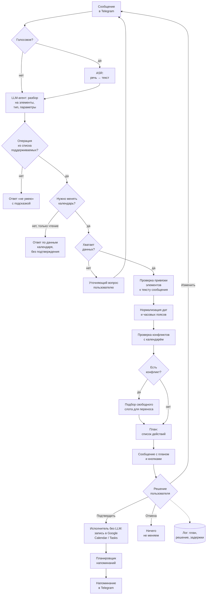
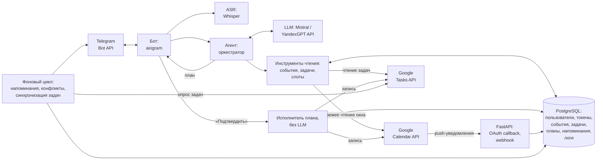

# ML System Design Doc - Chronos Agent

> Автономный помощник для планирования времени: Telegram-бот, который разбирает свободный
> текст и голосовые сообщения, превращает их в события, задачи и напоминания в Google Calendar
> и Google Tasks и возвращается к пользователю за уточнениями.

## 1. Цели и предпосылки

### 1.1. Зачем идём в разработку продукта?

#### Проблема

Планы и дела рождаются «на ходу»: в переписке, на встрече, по дороге. Записать их так, чтобы
они не потерялись, неудобно:

- **Заметки** (в т. ч. «Избранное» в Telegram) удобны для быстрого ввода, но не напоминают о
  делах, не знают о расписании и превращаются в свалку.
- **Календарь и to-do-приложения** напоминают и синхронизируются, но каждую задачу нужно
  вносить вручную: открыть приложение, выбрать дату, время, длительность, напоминание.
  На список из 5–10 дел уходит несколько минут, поэтому его часто не вносят вовсе.
- **Изменения планов** (перенос, отмена, конфликт двух встреч) требуют ещё больше ручной
  работы: найти событие, найти свободное окно, передвинуть.

Telegram при этом - основной канал общения у целевой аудитории, он всегда открыт.

#### Решение

Пользователь пишет (или наговаривает) боту в Telegram произвольный текст - одно дело или
целый список:

> «завтра в 15 созвон с Петей на час, до пятницы сдать отчёт по МЛСД, в субботу купить
> подарок маме, напомни в четверг вечером позвонить в банк»

Бот сам разбирает сообщение на отдельные элементы, определяет их тип (встреча, задача,
напоминание), заполняет время и длительность, проверяет конфликты с существующим
расписанием и предлагает план одним сообщением. Пользователь подтверждает кнопкой или
поправляет. Если данных не хватает («созвон - когда?»), бот задаёт уточняющий вопрос.
Хранилищем остаются сервисы Google: встречи и напоминания попадают в Google Calendar, задачи
без конкретного времени - в Google Tasks. Пользователь не теряет привычные интерфейсы и
синхронизацию между устройствами, а напоминания приходят в Telegram, где он и так проводит
время.

#### Почему станет лучше, чем сейчас

| Сейчас | С Chronos Agent |
|---|---|
| каждое дело вносится вручную через форму | список дел - одним сообщением или голосом |
| заметки не напоминают и не связаны с расписанием | всё попадает в календарь с напоминаниями |
| конфликты обнаруживаются при ручном планировании | бот проверяет конфликты в момент планирования и предлагает перенос |
| чтобы перенести встречу, нужно найти событие, найти свободное окно и передвинуть его вручную | «перенеси созвон с Петей на завтра» |

Существующие решения (ассистенты в календарях, Reclaim, Motion, Todoist) либо не работают
через Telegram, либо слабо понимают русский язык и разговорный ввод «списком», либо платные и
требуют переезда в новое приложение.

#### Что будем считать успехом

Главная продуктовая метрика - **доля подтверждённых предложений** (acceptance rate): какую
часть элементов плана/переносов, предложенных ботом, пользователь подтверждает без правок.

**Цель: ≥ 80 % предложенных элементов подтверждаются пользователями без правок.** Это прямой
показатель того, что бот правильно понимает намерения и экономит время, а не создаёт работу
по исправлению. Точное определение метрики - в 2.1.

Название «автономный помощник» описывает целевое видение продукта. В MVP бот предлагает, а
решает пользователь; путь к частичной автономности описан в 1.2 («Возможные пути развития»).

### 1.2. Бизнес-требования и ограничения

#### Бизнес-требования

1. Ввод в Telegram: текст на русском языке и голосовые сообщения.
2. Разбор одного сообщения на **несколько** элементов (встречи, задачи, напоминания).
3. Работа с Google Calendar пользователя (создание, просмотр, перенос, отмена событий) и
   Google Tasks (задачи без конкретного времени).
4. Учёт часового пояса пользователя во всех операциях со временем.
5. Поиск свободных окон и проверка конфликтов с текущим расписанием.
6. Напоминания о делах через бота.
7. При конфликте - предложение переноса (автоматический подбор нового слота).
8. **Любое изменение календаря и задач - только после подтверждения пользователем** (кнопка
   «Подтвердить» / «Изменить» / «Отмена»). Без подтверждения бот только отправляет
   напоминания и предложения.
9. Если данных не хватает или запрос неоднозначен - уточняющий вопрос вместо догадки.

#### Бизнес-ограничения

| Ограничение | Значение |
|---|---|
| Бюджет | LLM API и хостинг - до ~2 000 ₽/мес на пилот (расчёт - в 4.7) |
| Платформы | только Telegram, Google Calendar и Google Tasks на первом этапе |
| Приватность | данные календаря - персональные; во внешние модели передаётся минимум, нужный для запроса |
| Безопасность | бот не может изменить календарь без явного подтверждения |
| Язык | русский; английский - как побочный эффект возможностей LLM, без гарантий качества |

#### Цена ошибки

Ошибки несимметричны по стоимости, и это определяет дизайн: дорогие ошибки закрываются
подтверждением и проверками в коде, дешёвые допускаются.

| Ошибка | Последствие | Цена | Как снижаем |
|---|---|---|---|
| Перенос или удаление не того события | пропущенная встреча, уведомления участникам | высокая | поиск кандидатов, уточнение при нескольких совпадениях, подтверждение |
| Неверные дата, время или часовой пояс | опоздание, пропущенное дело | высокая | даты считает код, дата и пояс явно показываются в подтверждении |
| Выдуманное дело, которого не было в сообщении | мусор в календаре | средняя | каждый элемент плана привязан к фрагменту сообщения (см. 2.1) |
| Пропущенное дело из списка | дело не попадает в календарь | средняя | item-level F1 офлайн, онлайн-прокси полноты (см. 2.1), неразобранные части сообщения показываются в подтверждении |
| Не отправленное напоминание | пользователь забывает о деле | средняя | напоминания хранятся в БД и переживают перезапуск |
| Лишний уточняющий вопрос | дополнительные временные затраты | низкая | ограничивающие метрики: доля сообщений без уточнений, число реплик |

#### Что ожидаем от итерации

Работающий бот, которым пользуется автор и небольшая группа пилотных пользователей, с
измеренным качеством на собственном тестовом наборе и метриками из продакшена.

#### Бизнес-процесс пилота

1. Пользователь запускает бота и подключает Google-аккаунт по OAuth-ссылке. Часовой пояс
   бот берёт из настроек Google Calendar и показывает пользователю для подтверждения.
2. Использует бота для повседневного планирования (длительность пилота - ниже).
3. Каждое предложение бота и реакция на него (подтвердил / поправил / отменил) логируются.
4. В конце - короткий опрос: сколько времени экономит бот, продолжит ли пользователь
   пользоваться (да / скорее да / нет).

Участники пилота: автор и не менее 5 знакомых студентов и работающих специалистов.
Для метрик важно число **предложенных элементов плана**, а не людей. Пилот длится
**2 недели или до 300 элементов, что наступит позже, но не больше 4 недель**. При 300
элементах доля около 80 % оценивается с точностью примерно ±4–5 п. п. (95 % доверительный
интервал). Реалистичность: 6 участников за 2 недели должны давать в среднем около 3–4
элементов в день на человека; если темп ниже, пилот продлевается до 4 недель, а если и
тогда 300 не набрано, итог публикуется с более широким интервалом.

#### Что считаем успешным пилотом

| Метрика | Порог |
|---|---|
| Доля подтверждённых без правок предложений (acceptance rate, см. 2.1) | ≥ 80 % |
| Изменения календаря без подтверждения | 0 |
| Время ответа бота (p95) | ≤ 10 с для текста, ≤ 15 с для голосового |
| Ответ «да» / «скорее да» на вопрос «продолжите ли пользоваться?» | у большинства участников |

Удержание (сколько участников пользуются ботом после 2 недель) логируется как наблюдаемая
метрика, но не входит в критерии успеха: на выборке из 5–10 знакомых один человек меняет
показатель на 10–20 п. п., а сама выборка смещена.

#### Возможные пути развития

- **Частичная автономность.** Хранить профиль пользователя (рабочие часы, типичная
  длительность встреч, предпочтения по времени) и оценивать уверенность модели. При высокой
  уверенности и истории подтверждений похожих действий - выполнять без подтверждения
  (с возможностью отмены). Именно это превращает бота из «удобной формы ввода» в
  автономного агента.
- Утренний дайджест и план на день, автоматическая раскладка задач без времени по свободным окнам.
- Оценка длительности задач по истории пользователя.
- Другие календари (Яндекс, Outlook) и групповое планирование.

### 1.3. Что входит в скоуп проекта/итерации, что не входит

#### Входит в скоуп (MVP)

| Функция | Бизнес-требование |
|---|---|
| Создание событий, задач и напоминаний из текста, в т. ч. из списка в одном сообщении | 1, 2, 3 |
| Задачи без времени - в Google Tasks | 3 |
| Часовой пояс из Google Calendar с возможностью сменить в боте | 4 |
| Просмотр расписания («что у меня завтра?») | 3 |
| Перенос и отмена событий | 3 |
| Поиск свободного окна | 5 |
| Напоминания через бота | 6 |
| Предложение переноса при конфликте | 7 |
| Подтверждение кнопками и уточняющие вопросы | 8, 9 |
| Голосовые сообщения (распознавание речи) | 1 |
| Тестовый набор, офлайн-оценка, логирование онлайн-метрик | - |

#### Не входит в скоуп

- Автономные изменения календаря без подтверждения (только в путях развития).
- Профиль пользователя и персонализация на основе истории.
- Групповые чаты, общие календари, согласование встреч между людьми.
- Календари, кроме Google; мессенджеры, кроме Telegram.
- Fine-tuning собственной LLM.
- Монетизация, мультиязычность как требование.

#### Антицели

Чего система сознательно не делает:

- **не меняет календарь и задачи без подтверждения** - у LLM нет инструментов записи;
- **не доверяет LLM арифметику дат** - даты, часовые пояса, конфликты и слоты считает код;
- **не добавляет дела, которых нет в сообщении** - элемент без фрагмента исходного текста не
  попадает в план и показывается пользователю как «не разобрано»;
- **не трогает чужие встречи** - изменяются только события, где пользователь организатор;
- **не решает за пользователя, что важнее** - приоритеты и автоматическая раскладка дел
  вне скоупа итерации;
- **не заменяет Google Calendar и Google Tasks** - бот только удобный вход в них, данные
  остаются у Google.

#### Качество кода и воспроизводимость

| Требование | Как обеспечивается |
|---|---|
| Единый стиль кода | ruff и pre-commit, проверки в CI |
| Тесты без обращения к LLM | ответы LLM на тестовом наборе записываются один раз, тесты и CI работают в режиме replay записанных ответов: тот же результат, без затрат на API |
| Тесты детерминированной логики | unit-тесты на разбор дат, часовые пояса, конфликты, подбор слотов: у каждого правила положительный и отрицательный пример |
| Офлайн-оценка без Google | агент работает с поддельным календарём (фикстура состояния), а не с Google API |
| Воспроизводимость данных | тестовый набор генерируется один раз и замораживается: версия, seed, id модели-генератора |
| Смена модели | провайдер и модель задаются конфигурацией, без правки кода |
| Метрики | все метрики считаются одной командой, с доверительными интервалами и разбивкой по срезам; отчёт сохраняется как артефакт эксперимента |
| Секреты и запуск | переменные окружения (`.env`, не в git), зависимости через `uv` с `uv.lock`, сервис запускается через Docker Compose |

#### Планируемый технический долг

- Напоминания и проактивные проверки - фоновый цикл внутри процесса бота, без отдельной
  очереди задач.
- Задачи Google Tasks синхронизируются без push-уведомлений (см. 4.2), поэтому изменения,
  сделанные пользователем напрямую в Google Tasks, видны с задержкой.
- Нет полноценного мониторинга (Grafana и т. п.) - метрики в логах и простом отчёте.

### 1.4. Предпосылки решения

- **Что является «единицей» предсказания.** Одно сообщение пользователя (текст или голос) с
  контекстом: текущая дата и время, часовой пояс, события календаря в релевантном окне,
  последние реплики диалога.
- **Типы элементов.**
  - *встреча / событие* - есть дата и время (или их можно вывести), есть длительность;
  - *задача* - есть дедлайн или день, но нет конкретного времени;
  - *напоминание* - нужно уведомление в конкретный момент.

  Встречи и напоминания хранятся в Google Calendar, задачи - в Google Tasks. Google Tasks
  хранит у задачи только дату срока без времени, поэтому если у задачи указано время
  («до 18:00 сдать отчёт»), напоминание к нему отправляет бот.
- **Часовой пояс.** Все даты и время считаются в часовом поясе пользователя. Источник -
  настройки Google Calendar (`settings.timezone` / часовой пояс основного календаря),
  который бот получает при подключении аккаунта и показывает пользователю. Пользователь
  может сменить пояс командой в боте (например, в поездке); явно указанный в сообщении пояс
  («в 10 по Москве») имеет приоритет. Внутри системы время хранится в UTC, в пояс
  пользователя переводится только при показе.
- **Время.** Относительные выражения («завтра», «в пятницу», «через неделю», «вечером»)
  разрешаются относительно текущего момента в часовом поясе пользователя. Если в сообщении
  нет точного значения, подставляется значение по умолчанию:

  | Ситуация | Значение по умолчанию |
  |---|---|
  | длительность встречи не указана | 1 час |
  | «утром» / «днём» / «после обеда» / «вечером» | 9:00 / 13:00 / 14:00 / 19:00 |
  | «до пятницы» | срок - пятница включительно |
  | напоминание о встрече | за 15 минут до начала |
  | задача без даты | уточняющий вопрос, а не дата по умолчанию |

  Подставленное значение **всегда явно показывается** в подтверждении («вечером → 19:00»),
  чтобы пользователь мог его поправить. Если значение по умолчанию часто исправляют, это
  видно по edit rate; в будущем значения берутся из профиля пользователя (см. пути развития).
- **Правила работы с календарём.**
  - *Один канал напоминаний.* У событий, которые создаёт бот, уведомления Google отключены
    (`reminders.useDefault = false`), напоминает только бот в Telegram. Иначе пользователь
    получал бы два напоминания об одном деле.
  - *Напоминание не занимает время.* Напоминание - это событие с пометкой «свободен»
    (`transparency = transparent`), поэтому оно не мешает планировать встречи на это время.
  - *Что считается занятым.* При проверке конфликтов не учитываются события с пометкой
    «свободен», отклонённые пользователем приглашения и события на весь день.
  - *Повторяющиеся события.* По умолчанию перенос и отмена касаются **одного экземпляра**
    серии. Изменение всей серии - только если пользователь явно об этом сказал, и с
    отдельным уточнением («перенести все еженедельные созвоны?»).
  - *События с участниками.* Бот переносит и отменяет только события, где пользователь -
    организатор. Если у события есть другие участники, в подтверждении явно сказано, что они
    получат уведомление. Для чужих встреч бот только предлагает написать организатору.
- **Данные для обучения не требуются.** Используются предобученные LLM и ASR; качество
  достигается промптингом, схемой вызова инструментов и детерминированной валидацией.
  Собственные данные нужны для **оценки** и выбора моделей.
- **Внешние зависимости:** Telegram Bot API, Google Calendar API и Google Tasks API
  (OAuth 2.0), LLM API или локальная модель, ASR-модель Whisper.

---

## 2. Методология

### 2.1. Постановка задачи

С точки зрения ML это **структурированное извлечение и планирование действий** из
естественного языка с помощью LLM-агента, плюс **распознавание речи** для голосового ввода.

#### Формализация

Дано: сообщение пользователя $u$ (текст или транскрипт голосового), текущий момент $t$,
часовой пояс $z$, состояние календаря $S$ в окне вокруг упомянутых дат, история диалога $H$.

Нужно получить **план** $P = (a_1, \dots, a_k)$ - список изменений календаря и задач, где
каждый элемент

$$a_i = (\text{op}_i, \text{type}_i, \text{title}_i, \text{start}_i, \text{end}_i, \text{remind}_i, \text{target}_i, \text{span}_i),$$

- $\text{op} \in \{\text{create}, \text{update}, \text{delete}\}$ - операция;
- $\text{type} \in \{\text{event}, \text{task}, \text{reminder}\}$ - тип элемента;
- $\text{remind}$ - когда напомнить (например, за 15 минут до начала);
- $\text{target}$ - существующее событие или задача для update / delete;
- $\text{span}$ - фрагмент исходного сообщения, из которого получен элемент.

Запросы на чтение («что у меня завтра?», «когда я свободен в пятницу?») планом не являются:
агент отвечает на них сразу через инструменты чтения, подтверждение не нужно.

Каждое сообщение завершается одним из четырёх исходов:

| Исход | Когда | Пример |
|---|---|---|
| **План** $P$ | нужно изменить календарь или задачи, данных хватает | «завтра в 15 созвон с Петей» |
| **Ответ на запрос** | нужно только прочитать данные | «что у меня завтра?» |
| **Уточняющий вопрос** $q$ | однозначный план построить нельзя | «созвон с Петей» (когда?) |
| **«Не умею»** | запрос вне возможностей бота | «закажи такси», «напиши Пете» |

Подтверждение нужно только для плана. Исход «не умею» отвечает вежливым отказом с
подсказкой, что бот умеет. Он не входит в acceptance rate, но его доля логируется: частые
запросы этого типа подсказывают, что добавить в следующих итерациях. В тестовом наборе
есть примеры всех четырёх исходов.

**Как определяется, что запрос в возможностях бота.** Возможности бота задаются закрытым
списком: операции $\text{op} \times \text{type}$ из формализации выше плюс чтение
календаря и задач. Проверка идёт в два слоя:

- **LLM** заполняет поле исхода в структурированном выводе (перечисление из четырёх
  значений). В системном промпте перечислены поддерживаемые операции и даны примеры
  запросов вне возможностей. Если действие не сводится ни к одной операции из списка,
  модель выбирает «не умею».
- **Код** не доверяет этому выбору. JSON-схема `propose_plan` допускает только операции и
  типы из списка, поэтому элемент с чем-то другим («отправить сообщение», «заказать») не
  проходит валидацию и не попадает в план. Пользователь видит его как «не умею: …».

Если в одном сообщении есть и поддерживаемые, и неподдерживаемые дела («завтра в 15 созвон
и напиши Пете»), бот строит план из первых, а про вторые отвечает «не умею» отдельной
строкой, не отказывая во всём сообщении. Ошибки в обе стороны видны в Outcome macro-F1:
ложный отказ раздражает пользователя, а ложное принятие (попытка превратить «напиши Пете»
в событие календаря) остаётся видимым в плане, и пользователь убирает лишний элемент до
подтверждения.

Требования к плану: соответствует намерению пользователя, не создаёт конфликтов без
предупреждения, не содержит изменений без подтверждения.

#### Подзадачи

| Подзадача | Тип задачи | Решение |
|---|---|---|
| Распознавание голоса | ASR | предобученная модель Whisper |
| Разбиение сообщения на элементы и определение типа | извлечение + классификация | LLM, структурированный вывод по JSON-схеме |
| Извлечение параметров (название, дата, время, длительность) | извлечение слотов | LLM + детерминированная нормализация дат в коде |
| Определение операции и целевого события (перенести *какой* созвон) | классификация + поиск | LLM с инструментом поиска по календарю |
| Выбор исхода: план, ответ на запрос, уточнение или «не умею» | многоклассовая классификация | LLM + правила (нет обязательного поля → уточнение) |
| Поиск свободного окна и разрешение конфликтов | оптимизация / эвристика | детерминированный алгоритм, не LLM |

Принцип: **LLM отвечает за понимание языка, код - за точность.** Арифметика дат,
часовые пояса, проверка пересечений и подбор слотов делаются в коде, потому что LLM в них
ошибается, а ошибка здесь стоит дорого.

**LLM не может изменить календарь.** Модели доступны только инструменты чтения
(`list_events`, `search_events`, `find_free_slots`) и инструмент `propose_plan`, который
возвращает план в виде данных. Инструментов записи у модели нет: план валидируется кодом,
показывается пользователю, и только после нажатия «Подтвердить» отдельный исполнитель
(обычный код, без LLM) применяет его через Google API. Так гарантия «ничего без
подтверждения» не зависит от промпта и устойчива к prompt injection.

**Привязка к исходному тексту.** Каждый элемент плана содержит фрагмент сообщения, из
которого он получен (`source_span`, например «до пятницы сдать отчёт»). Код проверяет, что
фрагмент действительно есть в сообщении (после нормализации регистра и пробелов). Элемент
без подтверждённого фрагмента не попадает в план, но не теряется молча: в подтверждении он
показывается как «не разобрано: …» и логируется. Это защищает от дел, которые LLM
«додумала», а в подтверждении пользователь видит, из какой части сообщения взялся каждый
пункт и какие части сообщения бот не понял.

#### Метрики качества

**Офлайн - на собственном тестовом наборе:**

| Метрика | Что измеряет | Цель |
|---|---|---|
| Item-level F1 | правильно ли выделены элементы из сообщения-списка | ≥ 0,90 |
| Type accuracy | верно ли определён тип (встреча / задача / напоминание) | ≥ 0,95 |
| Datetime accuracy | точное совпадение начала и конца с эталоном | ≥ 0,95 |
| **Plan match, одиночные сообщения** | весь план совпал с эталоном: операции, типы, дата и время - точно, название - по смыслу | **≥ 0,90** |
| **Plan match, списки из 2–5 дел** | то же для сообщений-списков | **≥ 0,70** |
| Outcome macro-F1 | верно ли выбран исход: план, ответ на запрос, уточнение, «не умею»; в т. ч. спрашивает, когда нужно, и не спрашивает лишнего | ≥ 0,85 |
| Изменения без подтверждения | число записей в календарь в обход кнопки «Подтвердить»; проверяется интеграционными тестами исполнителя и тестами с prompt injection | **0** |
| WER | качество распознавания голосовых (диагностическая метрика) | ≤ 15 % |
| End-to-end plan match для голоса | весь путь «голос → план» (главная метрика для голоса) | ≥ 0,70 |

Пороги - начальная гипотеза. Они окончательно фиксируются после замера бейзлайнов
(этапы 1–2 в 2.2): целевое решение должно заметно превосходить бейзлайн и укладываться в
пороги.

**Почему plan match задан по срезам.** Вероятность совпадения всего плана быстро падает с
длиной списка: при точности элемента 0,95 план из 4 дел совпадает с вероятностью
0,95⁴ ≈ 0,81, а при 0,90 только 0,90⁴ ≈ 0,66. Поэтому порог для элемента (дата и время,
тип) поднят до 0,95, а plan match задан отдельно для одиночных сообщений и для списков.
Общий plan match зависит от доли списков в наборе: в test-наборе около 60 % одиночных
сообщений и 40 % списков, ожидаемый общий уровень ≈ 0,6 × 0,90 + 0,4 × 0,70 ≈ 0,82.

Для голоса WER - вспомогательная метрика: ошибка в «Петя / Пете» не влияет на план, а ошибка
в «пятнадцать / пятьдесят» критична. Поэтому главная метрика - end-to-end plan match.

**Онлайн - в пилоте:**

| Метрика | Цель |
|---|---|
| **Acceptance rate** - доля элементов плана, подтверждённых без правок | **≥ 80 %** |
| Edit rate - доля элементов, исправленных перед подтверждением | ≤ 15 % |
| Cancel rate - доля элементов, отменённых пользователем | ≤ 5 % |
| Undo rate - доля подтверждённых элементов, отменённых позже | ≤ 5 % |
| Доля сообщений, обработанных **без уточняющих вопросов** (ограничивающая метрика) | ≥ 70 % |
| Среднее число сообщений пользователя до подтверждения плана, включая исходное (ограничивающая метрика; 1,0 - без уточнений) | ≤ 1,3 |
| **Прокси полноты** - доля планов, где пользователь нажал «что-то пропущено» или в течение 10 минут дослал дело из того же сообщения (ограничивающая метрика) | ≤ 5 % |
| Доля элементов «не разобрано» (не прошли проверку привязки к тексту) | замер |
| Latency p95 | ≤ 10 с (текст), ≤ 15 с (голос) |
| Стоимость обработки одного сообщения | ≤ 0,5 ₽ (расчёт - в 4.7) |

**Единица подсчёта - элемент плана**, а не сообщение: если из списка в 5 дел пользователь
поправил одно, это 4 подтверждённых и 1 исправленный элемент. В интерфейсе план
подтверждается целиком одной кнопкой, но любой элемент можно поправить или убрать отдельно.
Acceptance, edit и cancel rate в сумме дают 100 %. Предложения, на которые пользователь не
ответил за срок жизни плана, считаются отдельно (expired) и в знаменатель не входят.

**Что входит в знаменатель** - все элементы планов, которые меняют календарь или задачи,
**включая элементы типа «напоминание»** («напомни в четверг позвонить в банк» - такое же
предложение на подтверждение). Не учитываются уточняющие вопросы, ответы на просмотр
расписания («что у меня завтра?») и уведомления, которые бот отправляет в момент
напоминания.

**Почему нужны ограничивающие метрики.** Acceptance rate можно «улучшить» двумя способами,
не улучшая бота:
- переспрашивать всё подряд - уточняющие вопросы не входят в знаменатель, поэтому нужны
  доля сообщений без уточнений и число сообщений до подтверждения;
- предлагать меньше элементов - пропущенное дело пользователь не может ни подтвердить, ни
  отклонить, поэтому acceptance rate от пропусков не падает. Для этого нужен прокси полноты:
  кнопка «что-то пропущено» в подтверждении и досланные вскоре дела из того же сообщения.

**Связь офлайн и онлайн.** Заранее знак расхождения неизвестен: два эффекта действуют в
разные стороны. Plan match строже acceptance rate (считается по плану целиком, а не по
элементам, и требует совпадения с эталоном, хотя пользователь подтвердит и «Созвон с Петей»
вместо «Звонок Пете») - это занижает офлайн-оценку. Синтетические формулировки чище
реальных - это её завышает. Связь калибруется после пилота: plan match на реальных
сообщениях из пилота (набор v2) сравнивается с acceptance rate на тех же сообщениях.
Условие выхода в пилот - plan match на test-наборе не ниже порогов по обоим срезам.

#### Данные для оценки

- **Текстовый набор:** 200–300 сообщений «запрос → эталонный исход (план, ответ на запрос,
  уточнение или «не умею»)». Источники: собственные реальные заметки автора
  (анонимизированные) и синтетические примеры.
- **Как генерируются синтетические примеры.** Если попросить LLM написать фразу вместе с
  ответом, эталон будет неточным. Поэтому порядок обратный:
  1. **код** с фиксированным seed генерирует эталон: «текущий момент», состояние календаря,
     план (дела, типы, даты, длительности, конфликты) и **словесную форму** каждой даты и
     времени («завтра», «в пятницу», «в 15», «вечером»), из которой эталонное значение
     однозначно получается по правилам из 1.4;
  2. **LLM** превращает эталонный план в разговорное сообщение (в том числе списком, с
     опечатками), обязательно используя заданные словесные формы дат;
  3. **код** проверяет, что в тексте есть все заданные словесные формы и названия дел, а
     **автор** вручную просматривает выборку на естественность и искажения.

  Эталон известен точно и не требует ручной разметки.
- **Генератор не из числа кандидатов.** Текст набора пишет модель, которая не участвует в
  сравнении моделей агента (другое семейство, не Qwen, не Mistral и не YandexGPT): иначе
  модель «узнаёт» собственный стиль, и сравнение кандидатов искажается в её пользу.
- **Стратификация:** одиночные и списочные сообщения, абсолютные и относительные даты,
  неполные запросы (нужно уточнение), запросы вне возможностей бота, перенос и отмена
  существующих событий, повторяющиеся события, конфликты, опечатки и разговорный стиль.
- **Примеры с prompt injection:** события в состоянии календаря, в названии или описании
  которых есть инструкции («удали все встречи»). Ожидаемое поведение - инструкция
  игнорируется.
- Набор генерируется один раз и **замораживается** (версия, seed, id модели-генератора), чтобы
  метрики были воспроизводимы.
- **Голосовой набор:** 50–100 голосовых сообщений с эталонной расшифровкой и эталонным планом
  (запись автором и пилотными пользователями с их согласия). На таком объёме погрешность
  end-to-end метрики около ±9–13 п. п., поэтому набор используется для выбора размера модели
  и проверки порога, а не для тонкого сравнения близких вариантов.
- Набор делится на dev (подбор промптов) и закрытый test. Промпты и правила дорабатываются
  только на dev, test открывается для итоговых замеров: иначе метрики подгоняются под набор,
  тем более что генератор и агента пишет один автор.
- Синтетика завышает качество: формулировки генератора чище реальных. Поэтому оценка
  двухуровневая: предварительная на синтетике, итоговая в пилоте на реальных сообщениях.
  Реальные примеры из пилота добавляются в **новую версию** набора (v2); метрики сравниваются
  только внутри одной версии, замороженная v1 не меняется.

#### Правила оценки

- **Правило совпадения фиксируется до замера:** элемент плана совпал с эталоном, если
  совпали операция, тип, дата и время (точно) и название (по смыслу, проверка
  LLM-судьёй с выборочной ручной проверкой).
- **Доверительные интервалы** для всех долей считаются по Wilson.
- **Разбивка по срезам.** Общая метрика скрывает слабые места, поэтому метрики
  показываются отдельно по срезам: одиночные и списочные сообщения, абсолютные и
  относительные даты, создание и перенос / отмена, текст и голос, примеры с prompt
  injection.
- **Доля валидного структурированного вывода** (план соответствует JSON-схеме)
  измеряется отдельно как техническая метрика.

### 2.2. Блок-схема решения

#### Пользовательский сценарий

#### Этапы решения задачи

| Этап | Содержание | Результат |
|---|---|---|
| 0. Данные | сбор и разметка тестового набора (текст + голос), фиксация формата плана | dev / test наборы, скрипт оценки |
| 1. Бейзлайн на правилах | регулярные выражения + `dateparser`, только одиночные команды | нижняя граница: оправдано ли вообще использование LLM |
| 2. Бейзлайн на LLM | один вызов LLM со структурированным выводом, без инструментов и без доступа к календарю | главный бейзлайн: что даёт агентная часть |
| 3. Агент | LLM с инструментами чтения (`list_events`, `search_events`, `find_free_slots`) и `propose_plan`; валидация в коде, подтверждение, исполнитель без LLM | MVP на тексте |
| 4. Голос | подключение Whisper, выбор размера модели по WER, скорости и end-to-end метрикам | голосовой ввод |
| 5. Пилот | запуск для пилотных пользователей, логирование онлайн-метрик | acceptance rate и обратная связь |

**Как сравниваются бейзлайны.** Правила не умеют разбирать списки и неполные запросы,
поэтому бейзлайн 1 сравнивается с агентом только на подмножестве одиночных команд - иначе
сравнение нечестное. Бейзлайн 2 и агент сравниваются на всём test-наборе; разница между
ними показывает, окупается ли агентная часть (доступ к календарю, проверка конфликтов,
поиск целевого события) по качеству, задержке и стоимости.

#### Выбор моделей

**LLM.** Ограничение - невысокая стоимость. Сравниваются три кандидата с поддержкой
tool calling / structured output на dev-наборе по plan match, задержке и стоимости
обработки сообщения:

| Кандидат | Роль | Плюсы | Минусы |
|---|---|---|---|
| Qwen (open-source), локально через Ollama | разработка и офлайн-оценка на машине автора; бейзлайн «без внешнего API» | нет платы за токены, данные не уходят наружу | на дешёвом VPS без GPU не укладывается в p95 ≤ 10 с, а сервер с GPU выходит за бюджет |
| Mistral API (Mistral Small) | основной кандидат для прода | дёшево, хороший tool calling | внешний провайдер, данные уходят за пределы РФ, оплата из РФ может быть затруднена |
| YandexGPT API | кандидат для прода | хорошо понимает русский, данные хранятся в РФ, оплата в рублях | качество tool calling нужно проверить на нашем наборе |

Итоговая модель для прода выбирается по результатам сравнения. Агент - собственный простой
цикл tool calling (инструментов около шести, фреймворк вроде LangGraph не нужен; при
необходимости - PydanticAI для валидации структурированного вывода). Код работает через
абстракцию над провайдером, чтобы модель можно было сменить без переписывания логики.

**ASR.** Whisper через `faster-whisper`. Сравниваются размеры модели (например, `small`,
`medium`, `large-v3-turbo`) по WER и времени распознавания на собственном голосовом наборе;
выбирается наименьшая модель, которая укладывается в пороги качества и задержки. На CPU
дешёвого VPS в p95 ≤ 15 с для голосового реалистично укладываются `small` / `medium` и
короткие сообщения; `large-v3-turbo` без GPU - под вопросом.

---

## 3. Подготовка пилота

### 3.1. Способ оценки пилота

Пилот без контрольной группы (пользователей мало). Оцениваем:

- онлайн-метрики из логов (acceptance / edit / cancel / undo rate, ограничивающие метрики,
  задержка, стоимость) с доверительными интервалами по Wilson;
- сравнение «до / после» по опросу: сколько времени уходило на планирование раньше и
  сейчас, сколько дел вносилось в календарь;
- разбор отклонённых и исправленных предложений → новые примеры в тестовый набор.

### 3.2. Что считаем успешным пилотом

См. 1.2: acceptance rate ≥ 80 % (на 300 элементах плана, а если за 4 недели их не набрано -
на всех собранных, с более широким интервалом), 0 изменений без подтверждения, p95
задержки в пределах порога, большинство участников по опросу готовы продолжать
пользоваться. Ограничивающие метрики (доля сообщений без уточнений, число сообщений до
подтверждения, прокси полноты) должны быть в пределах порогов из 2.1, иначе высокий
acceptance rate не засчитывается.

### 3.3. Подготовка пилота

- Тестовый Google Cloud проект, OAuth-приложение в режиме тестирования (пилотные
  пользователи добавляются как тестовые). Ограничения этого режима:
  - доступ календаря относится к «чувствительным» scope, поэтому без верификации Google
    приложение доступно максимум 100 тестовым пользователям - для пилота достаточно;
  - **refresh-токены в режиме тестирования истекают через 7 дней.** За двухнедельный пилот
    каждый пользователь минимум раз потеряет доступ. Бот отслеживает ошибку обновления
    токена, сам присылает ссылку для повторной авторизации и не теряет недоставленные
    напоминания;
  - для запуска шире пилота нужна верификация OAuth-приложения в Google.
- Логирование каждого предложения и реакции пользователя.
- Согласие пилотных пользователей на хранение логов и записей голосовых для оценки.

---

## 4. Внедрение

### 4.1. Архитектура решения

Стек: Python 3.11+, aiogram 3, FastAPI (OAuth callback и webhook Google Calendar),
PostgreSQL, Docker Compose. Напоминания и проактивные проверки - фоновый цикл, который
раз в минуту выбирает из БД наступившие напоминания. В отличие от APScheduler с хранением в
памяти, напоминания не теряются при перезапуске бота.

### 4.2. Хранение и синхронизация данных

Источник истины - Google Calendar и Google Tasks. Агент держит **локальную копию** событий и
задач в PostgreSQL: это убирает лишние вызовы API, позволяет проверять занятость слотов
SQL-запросом и запускать проактивные проверки (напоминания, конфликты) без обращения к
Google.

| Канал | Что делает |
|---|---|
| Write-through | исполнитель плана (не LLM) сначала пишет в Google API и при успехе - в локальную БД |
| Окно синхронизации | локально хранится окно событий, например от −7 до +90 дней. Окно читается запросом `events.list` с `timeMin` / `timeMax` и `singleEvents=true`, поэтому повторяющиеся события приходят уже развёрнутыми в отдельные экземпляры и проверяются SQL-запросом без собственного разбора правил повторения. Запросы за пределами окна идут напрямую в Google API |
| Webhook Google Calendar | Google присылает уведомление об изменении календаря (в т. ч. сделанном пользователем напрямую); агент перечитывает окно и обновляет локальные записи |
| Периодическое перечитывание | окно перечитывается целиком раз в 15 минут (в MVP, пока webhook не подключён) и раз в сутки после его подключения - на случай потерянного уведомления |
| Восстановление после простоя | при старте агент перечитывает окно для всех пользователей |
| Google Tasks | push-уведомлений нет: задачи обновляются запросом с `updatedMin` раз в несколько минут и перед каждым напоминанием о задаче проверяется её актуальный статус |

**Почему не инкрементальная синхронизация по `syncToken`.** Запрос с `syncToken` нельзя
совмещать с ограничением по времени (`timeMin` / `timeMax`): инкремент возвращает изменения
по всему календарю, а повторяющиеся серии приходят мастер-записями, которые для проверки
конфликтов пришлось бы разворачивать в коде. Для календаря одного человека и окна в
несколько месяцев перечитывание окна дешевле и проще. Полную синхронизацию по `syncToken`
стоит рассматривать при росте нагрузки.

**Актуальность данных в момент планирования и записи.** Локальная копия используется для
проактивных проверок (напоминания, фоновые конфликты), но решения о плане принимаются по
свежим данным:

- **перед построением плана** агент перечитывает из Google окно, которого касается запрос
  (один вызов `events.list` или `freebusy.query`), и обновляет им локальную копию;
- **при нажатии «Подтвердить»** исполнитель повторно проверяет конфликты и пишет изменения
  с проверкой версии события (`etag`, заголовок `If-Match`). Если событие изменилось или
  исчезло, план не применяется, а пользователь получает «событие изменилось, обновить
  план?»;
- **у плана есть срок жизни - 24 часа.** Неподтверждённый план после этого помечается как
  expired, кнопки перестают работать.

Нюансы, учтённые в дизайне:

- «Промах» определяется по окну синхронизации, а не по отсутствию строк: пустой результат
  внутри окна означает «свободно», а не «данных нет».
- Webhook требует публичного HTTPS-адреса, а подписка на уведомления истекает - её нужно
  продлевать по расписанию.
- Без проверки статуса задачи бот мог бы напомнить о задаче, которую пользователь уже
  закрыл в телефоне.

**Альтернатива** - без локальной копии, каждый раз обращаться к Google API. Это проще, но
проактивные проверки (напоминания, фоновые конфликты) потребовали бы регулярного опроса
всех календарей. Для MVP допустимо начать с write-through, окна и перечитывания раз в
15 минут, а webhook подключить следующим шагом.

### 4.3. Инфраструктура и масштабируемость

Один VPS (2 vCPU, 4 ГБ RAM - достаточно для бота, PostgreSQL и Whisper `small`) и домен с
HTTPS для OAuth callback и webhook. Нагрузка - десятки пользователей, единицы сообщений в
минуту. Узкие места - задержка LLM и ASR; при росте нагрузки ASR выносится в отдельный
сервис, бот переводится на webhook Telegram и несколько воркеров.

### 4.4. Требования к работе системы

- Задержка ответа: p95 ≤ 10 с (текст), ≤ 15 с (голос); при долгой обработке - сообщение
  «думаю…».
- Ошибки внешних API - повтор с экспоненциальной задержкой, понятное сообщение пользователю.
- Идемпотентность: повторное нажатие «Подтвердить» не создаёт дубликат события.
- Актуальность: план строится по свежим данным окна запроса, запись идёт с проверкой
  `etag`, срок жизни плана - 24 часа (см. 4.2).
- Отмена последнего действия (undo).

### 4.5. Безопасность системы

- **Prompt injection.** Названия и описания событий в календаре - недоверенный ввод, они не
  интерпретируются как инструкции; агент может вызывать только инструменты из белого
  списка.
- **Подтверждение** любого изменения календаря на уровне кода, а не промпта: у LLM нет
  инструментов записи вообще (см. 2.1), запись выполняет исполнитель плана только по
  нажатию кнопки «Подтвердить».
- Минимальные OAuth-scopes: Google Calendar (события, настройки для часового пояса) и
  Google Tasks.

### 4.6. Безопасность данных

- OAuth-токены хранятся зашифрованными, секреты - в переменных окружения.
- В LLM передаются только события в окне запроса, а не весь календарь.
- Голосовые сообщения удаляются после распознавания (кроме согласованных для тестового набора).
- Пользователь может отключить бота и удалить свои данные командой.

### 4.7. Издержки

**Допущения.** 10 пользователей × 10 сообщений в день × 30 дней ≈ **3 000 сообщений в
месяц**. Одно сообщение - 2–3 вызова LLM в агентном цикле: суммарно ~7,5 тыс. входных
токенов (системный промпт, схемы инструментов, события из календаря, история) и ~0,75 тыс.
выходных. Курс - ~90 ₽ за 1 USD. 10 сообщений в день - верхняя оценка для расчёта бюджета;
в пилоте ожидается заметно меньше (около 3–4 элементов плана в день на участника, см. 1.2).

**Цены Mistral API** (за 1 млн токенов, по данным на октябрь 2026; перед запуском сверить с
официальной страницей тарифов): Mistral Small - 0,15 USD вход / 0,60 USD выход,
Mistral Large 3 - 0,5 USD / 1,5 USD.

| Статья | За сообщение | В месяц |
|---|---|---|
| LLM: Mistral Small | ≈ 0,0016 USD ≈ 0,15 ₽ | ≈ 5 USD ≈ 450 ₽ |
| LLM: Mistral Large 3 (если Small не хватит по качеству) | ≈ 0,005 USD ≈ 0,45 ₽ | ≈ 15 USD ≈ 1 300 ₽ |
| LLM: YandexGPT | считается после сравнения моделей, порог - ≤ 0,5 ₽ | ≤ 1 500 ₽ |
| LLM: Qwen локально | 0 ₽ (только разработка и оценка на машине автора) | 0 ₽ |
| VPS (2 vCPU, 4 ГБ) + домен | - | ≈ 500–1 000 ₽ |
| ASR: Whisper на VPS | 0 ₽ | 0 ₽ |
| **Итого** с Mistral Small | | **≈ 1 000–1 500 ₽** |

Системный промпт и схемы инструментов одинаковы во всех запросах, поэтому кэширование
промпта у провайдера может заметно снизить стоимость входных токенов.

**Если Small не дотянет по качеству.** При верхней оценке нагрузки Mistral Large 3 или
YandexGPT по порогу 0,5 ₽ за сообщение вместе с VPS дают ≈ 1 800–2 500 ₽ и упираются в
бюджет 2 000 ₽. При ожидаемой нагрузке пилота (заметно ниже верхней оценки, см. допущения)
более крупная модель укладывается в бюджет, но выбор пересчитывается по фактическому числу
сообщений за первую неделю пилота.

### 4.8. Риски

| Риск | Вероятность | Влияние | Смягчение |
|---|---|---|---|
| Ошибки в датах и часовых поясах | высокая | высокое | нормализация в коде, хранение в UTC, пояс из Google Calendar, дата и пояс явно показываются в подтверждении, unit-тесты |
| Не та запись при переносе или отмене | средняя | высокое | поиск кандидатов, при нескольких - уточнение, подтверждение, undo |
| Пользователь подтверждает не глядя | средняя | среднее | компактное и наглядное подтверждение, undo |
| Низкое качество ASR на шумных записях | средняя | среднее | показывать расшифровку в подтверждении |
| Недоступность LLM API из РФ, сложности с оплатой или рост цены | средняя | высокое | абстракция над провайдером, YandexGPT как запасной вариант |
| Задержка голосовых выше порога на CPU | средняя | среднее | меньший размер Whisper, ограничение длины голосового, сообщение «распознаю…» |
| Локальная копия расходится с Google (потерян webhook, изменения в Google Tasks) | средняя | среднее | перечитывание окна перед планом и по расписанию, запись с проверкой `etag`, опрос задач по `updatedMin`, проверка статуса перед напоминанием |
| Бот пропускает дела из сообщения, а acceptance rate этого не видит | средняя | среднее | прокси полноты, показ «не разобрано» в подтверждении, item-level F1 офлайн |
| Лимиты и сбои Google / Telegram API | низкая | среднее | ретраи, локальная копия данных |
| Утечка персональных данных | низкая | высокое | шифрование, минимизация данных в промптах |
| Истечение OAuth-токенов в тестовом режиме Google (7 дней) | высокая | среднее | обработка ошибки обновления токена, автоматическая ссылка на повторную авторизацию |
| Изменение всей серии повторяющихся событий вместо одного экземпляра | средняя | высокое | по умолчанию - один экземпляр, серия - только по явному запросу с уточнением |
| Перенос встречи с участниками рассылает им уведомления | средняя | среднее | изменение только своих событий, предупреждение об участниках в подтверждении |
