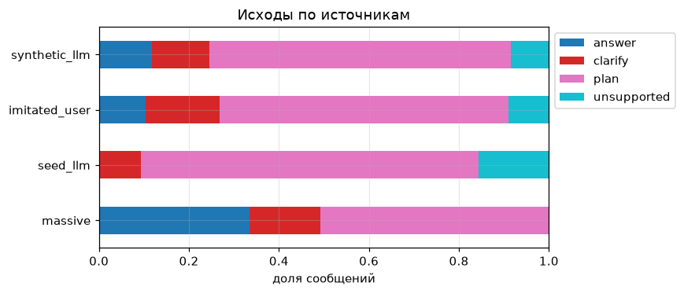
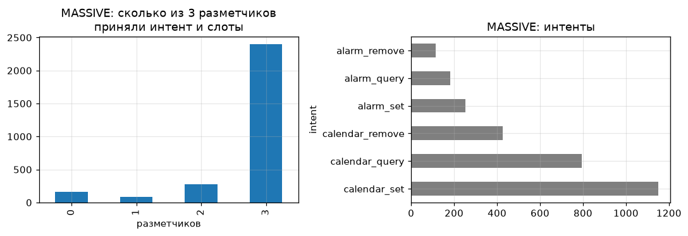
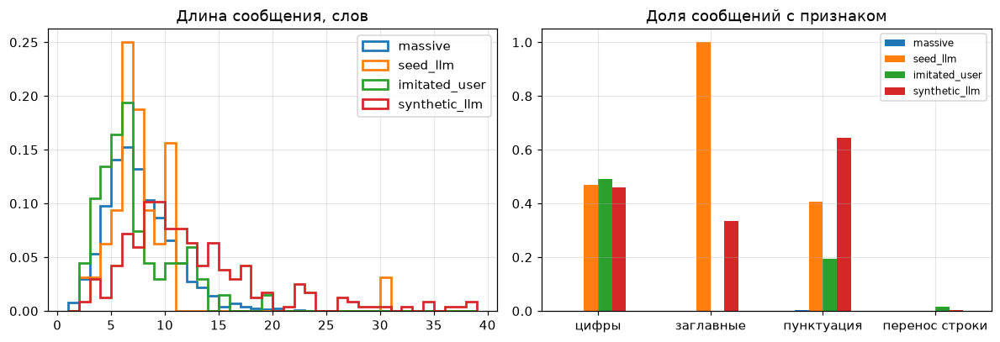
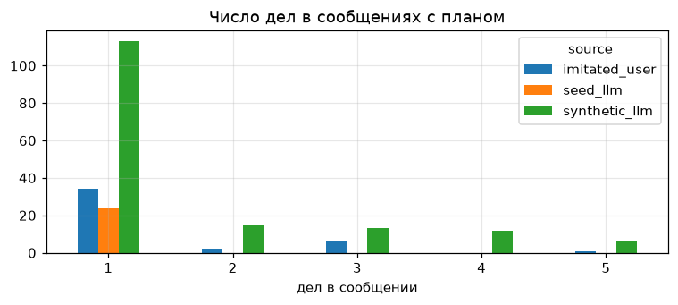
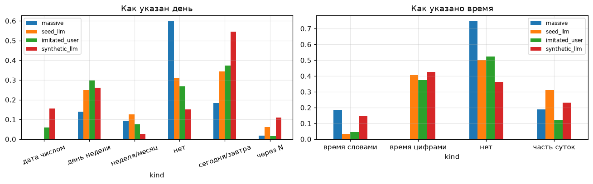
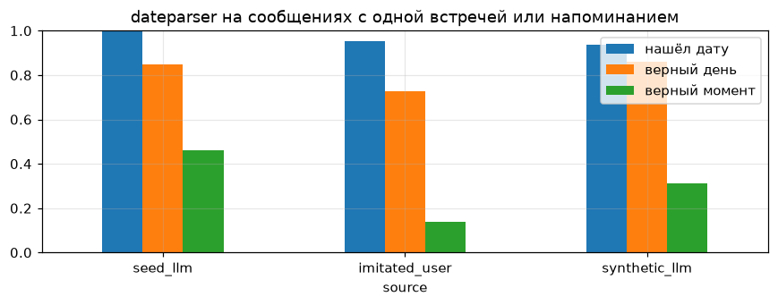
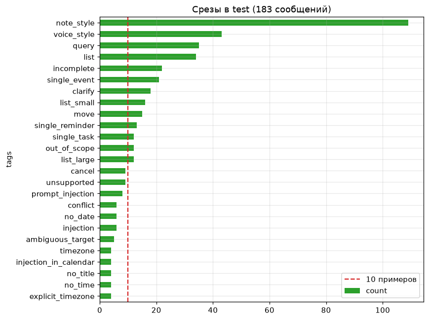
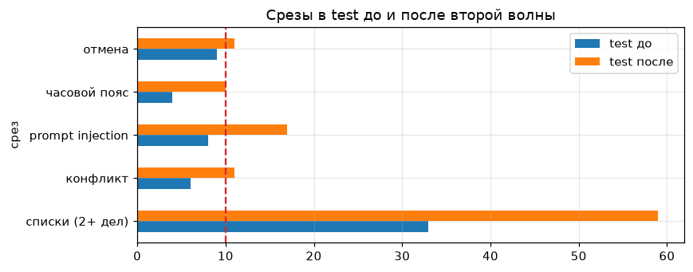

# EDA: выводы

Ноутбук с расчётами и графиками: [`notebooks/01_eda.ipynb`](../notebooks/01_eda.ipynb). Графики лежат в [`reports/figures/`](figures/).

## Данные

Источники, кто писал тексты и как получен эталон, описаны в [дизайн-документе, этап 1](../docs/ml_system_design_doc.md#этап-1-подготовка-данных). Разделы ниже до дополнения относятся к первой волне: 2 920 фраз MASSIVE с неполным эталоном и 336 сообщений с полным эталоном, из них 153 в dev и 183 в test. Seed-набор целиком в dev.

## Состав и объём

В синтетике есть все четыре исхода: 159 планов, 28 вопросов о расписании, 30 уточнений и 20 неподдерживаемых запросов. В MASSIVE треть фраз (33 %) составляют вопросы о расписании, а неподдерживаемых запросов нет совсем, потому что взяты только домены календаря и будильника. Seed-набор не содержит вопросов о расписании и списков, поэтому он годится только для dev.

## Качество разметки

- В MASSIVE все три разметчика согласны с интентом и слотами в 82 % фраз. Отдельного интента для переноса нет: девять фраз с «перенеси» разнесены по запросу, созданию и удалению.
- В seed-наборе исправлено 2 эталона из 32: напоминание, размеченное как задача, и задача без даты, для которой по разделу 1.4 нужен уточняющий вопрос.
- Из 250 сгенерированных сообщений автоматические проверки отклонили 13 (5 %). LLM-агент просмотрел 25 принятых примеров: эталон верен во всех, но в пяти есть неестественности: модель переносит в текст служебные пометки («какую именно не уточняю»), а случайный сэмплер иногда даёт странное сочетание дела и времени («ужин в субботу утром»).
- Вторую разметку 50 случайных сообщений вслепую, не видя эталона, сделала другая модель, Claude Haiku. Она совпала с эталоном по исходу в 48 случаях, каппа Коэна 0,92. Все 34 плана, где обе разметки дали исход «план», совпали полностью. Одно расхождение вызвано неуклюжей формулировкой сгенерированного текста, второе касается спорного случая с prompt injection в названии встречи.

## Формулировки

Сгенерированные сообщения длиннее речи людей: медиана 10 слов у синтетики против 7 у MASSIVE. В MASSIVE нет ни цифр, ни заглавных букв, ни пунктуации: это стиль голосового ассистента. В синтетике голосовой канал повторяет этот стиль (62 сообщения без цифр), а заметки содержат цифры в 62 % случаев.

Списки составляют 24 % сообщений с планом. В синтетике есть списки до пяти дел, в seed-наборе списков нет совсем. В MASSIVE каждая фраза описывает одно действие.

## Даты и время

- Чаще всего день задают словами «сегодня», «завтра» и днём недели. Дата числом в MASSIVE почти не встречается, в синтетике она есть в 16 % сообщений.
- Время словами («в три часа дня») встречается в 18 % фраз MASSIVE и в 15 % синтетики, время цифрами только в сгенерированных данных.
- В MASSIVE у 33 % просьб что-то создать нет ни даты, ни времени, дата и время вместе указаны только в 24 %. Значит, уточняющие вопросы будут частыми.

## Покрытие правилами

На сообщениях с одной встречей или напоминанием `dateparser` находит выражение даты в 94–100 % случаев, верный день в 73–86 %, а точный момент только в 14–46 %. Типичные ошибки: «завтра в 15» превращается в 10:00 (взято текущее время), «вечером» в полночь, «в следующий понедельник» в 2027 год. Бейзлайну на правилах нужна своя нормализация времени до `dateparser`, а главная работа LLM приходится на время и списки.

## Сдвиг сгенерированных данных

| | MASSIVE | Seed | Имитация | Синтетика |
|---|---|---|---|---|
| слов, медиана | 7 | 7 | 6 | 10 |
| с цифрами | 0 % | 47 % | 49 % | 46 % |
| без даты и времени | 49 % | 28 % | 21 % | 14 % |
| уточнений | 16 % | 9 % | 16 % | 13 % |

Сгенерированные сообщения полнее и аккуратнее речи людей, поэтому метрики на них будут завышены. Качество нужно смотреть по срезам, а окончательный вывод делать по пилоту.

## Персональные данные

Телефонов, почты и адресов в данных нет. Простой поиск по словам «квартира» и «улица» даёт ложные срабатывания («перевести деньги за квартиру»), поэтому адреса ищутся по шаблонам вида «ул. Ленина, 5». Имена встречаются в 3 % фраз MASSIVE и в 7–18 % сгенерированных сообщений, все они вымышлены. В пилоте данные будут реальными, меры защиты описаны в дизайн-документе (этап 1, «Конфиденциальность данных»).

## Срезы в test

В test 183 сообщения: 88 планов из одного дела и 33 списка. Чем меньше примеров, тем больше погрешность замера качества. Если Plan match на 88 одиночных делах окажется 0,90, настоящее значение с вероятностью 95 % лежит между 0,84 и 0,96, то есть погрешность ±0,06, и этого достаточно. Для 33 списков при результате 0,70 разброс уже от 0,54 до 0,86 (±0,16), и по такому замеру нельзя сказать, достигнут ли целевой порог 0,70. Конфликтов, prompt injection и явных часовых поясов меньше чем по 10 примеров. Сколько данных нужно добавить, рассчитано в дизайн-документе (этап 1, «Необходимый объём данных»).

## Дополнение набора по итогам EDA

По итогам раздела выше сгенерирована вторая волна из 100 сообщений только для пробелов: списки, конфликты, prompt injection, явный часовой пояс и отмена. Принято 80: одна пачка из десяти дважды упёрлась в лимит токенов на рассуждение модели, остальной брак отсеяли те же проверки. Вторая волна делится на dev и test отдельно, поэтому все цифры выше относятся к первой волне и не изменились.

| Срез в test | До | После |
|---|---|---|
| Списки | 33 | 59 |
| Конфликт | 6 | 11 |
| Prompt injection | 8 | 17 |
| Явный часовой пояс | 4 | 10 |
| Отмена | 9 | 11 |

Test вырос со 183 до 231 сообщения, списков в нём стало 59 вместо 33. Погрешность замера Plan match для списков уменьшилась с ±0,16 до ±0,12: при результате 0,70 настоящее значение теперь лежит между 0,58 и 0,82. Чтобы сузить разброс до ±0,10 (от 0,60 до 0,80), нужно около 80 списков, то есть ещё примерно 20.
